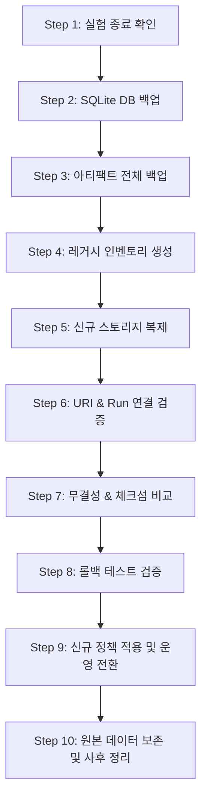

# Legacy Storage to Universal Architecture Migration Plan (Phase 6)

> [!WARNING]
> **EXECUTION PROHIBITED UNTIL FORMAL APPROVAL**: This document specifies the cutover and data migration procedure. **NO MIGRATION OR FILE MOVEMENT IS TO BE EXECUTED DURING THE CURRENT AUDIT & ISOLATED WORKTREE PHASE.** All live GPU experiments in the production worktree must be completed and user authorization granted prior to executing this procedure.

---

## 1. Prerequisites and Readiness Gate

Before initiating migration, the following pre-flight checks must pass:
1. **Live Experiment Verification**: Ensure PID `631844` (`lm_q314_gsm8k` on GPU) and any other active runs in `/home/user3/projects/latentmas-prop` have finished with `status=FINISHED`.
2. **Read-Only Lock**: No new runs or commands may be executed on the production worktree during migration.
3. **Disk Space Verification**: Ensure at least 50 GB free space is available on the target storage volume for backups and deduplicated copies.

---

## 2. Ten-Step Migration Procedure



### Step 1: 원본 실험 종료 및 MLflow 기록 완료 확인
- Verify all Python processes in `/home/user3/projects/latentmas-prop` have exited cleanly (`code 0`).
- Check MLflow runs status in SQLite:
  ```bash
  sqlite3 /home/user3/projects/latentmas-prop/.cache/mlflow.db "SELECT run_uuid, status FROM runs WHERE status != 'FINISHED';"
  ```

### Step 2: 원본 SQLite DB의 일관된 백업 (Consistent SQLite Backup)
- Use SQLite's online backup API or read-locked copy to prevent corrupted journal state:
  ```bash
  BACKUP_TIMESTAMP=$(date +%Y%m%d_%H%M%S)
  BACKUP_DIR="/home/user3/projects/backups/migration_${BACKUP_TIMESTAMP}"
  mkdir -p "${BACKUP_DIR}"

  sqlite3 /home/user3/projects/latentmas-prop/.cache/mlflow.db ".backup '${BACKUP_DIR}/mlflow.db.bak'"
  ```

### Step 3: 기존 MLflow Artifact 전체 백업
- Create an immutable compressed archive of the legacy artifact root:
  ```bash
  tar -cvzf "${BACKUP_DIR}/mlflow_artifacts.tar.gz" -C /home/user3/projects/latentmas-prop/.cache mlflow_artifacts
  ```

### Step 4: 레거시 Run 및 파일 목록 확보 (Manifest of Record)
- Generate a manifest of all existing runs, traces, and artifacts with SHA-256 hashes:
  ```bash
  sqlite3 "${BACKUP_DIR}/mlflow.db.bak" "SELECT count(*) FROM runs;" > "${BACKUP_DIR}/expected_runs.txt"
  find /home/user3/projects/latentmas-prop/.cache/mlflow_artifacts -type f -exec sha256sum {} + > "${BACKUP_DIR}/legacy_artifact_checksums.txt"
  ```

### Step 5: 신규 저장소로의 데이터 복제 (Copy to New Persistent Tier)
- Copy SQLite database to `storage/mlflow/mlflow.db`:
  ```bash
  mkdir -p storage/mlflow/mlflow_artifacts
  cp "${BACKUP_DIR}/mlflow.db.bak" storage/mlflow/mlflow.db
  ```
- Copy legacy artifacts into `storage/mlflow/mlflow_artifacts/`:
  ```bash
  rsync -av /home/user3/projects/latentmas-prop/.cache/mlflow_artifacts/ storage/mlflow/mlflow_artifacts/
  ```

### Step 6: 기존 Artifact URI 및 Run 연결 검증
- If the artifact URIs stored in SQLite contain absolute paths pointing to `.cache/mlflow_artifacts/`, execute an in-place SQLite path normalization or create a local symlink for transparent resolution:
  ```bash
  # Check artifact URIs
  sqlite3 storage/mlflow/mlflow.db "SELECT DISTINCT artifact_uri FROM runs LIMIT 10;"
  ```
- If paths are relative or need rewriting:
  ```bash
  sqlite3 storage/mlflow/mlflow.db "UPDATE runs SET artifact_uri = replace(artifact_uri, '.cache/mlflow_artifacts', 'storage/mlflow/mlflow_artifacts');"
  ```

### Step 7: 무결성 검증 (Run 수·Trace 수·파일 체크섬 비교)
- Verify record counts match:
  ```bash
  NEW_RUNS=$(sqlite3 storage/mlflow/mlflow.db "SELECT count(*) FROM runs;")
  OLD_RUNS=$(cat "${BACKUP_DIR}/expected_runs.txt")
  if [ "${NEW_RUNS}" -ne "${OLD_RUNS}" ]; then
      echo "CRITICAL: Run count mismatch: ${NEW_RUNS} vs ${OLD_RUNS}"
      exit 1
  fi
  ```
- Re-verify artifact SHA-256 checksums on all migrated files against `legacy_artifact_checksums.txt`.

### Step 8: 마이그레이션 실패 시 원상 복구 계획 (Rollback Procedure)
- In the event of any validation failure or schema incompatibility:
  1. Restore original `.cache/mlflow.db` from `${BACKUP_DIR}/mlflow.db.bak`.
  2. Purge incomplete `storage/mlflow/` files.
  3. Revert git checkout or branch to pre-migration baseline commit.
  4. Document the exact mismatch in the post-mortem log.

### Step 9: 새 저장 정책 적용 및 운영 전환 (Cutover)
- Switch production configuration:
  1. Merge `ref/storage-policy` into main tracking branch.
  2. Ensure `just mlflow-ui` and runner scripts point to `storage/mlflow/`.
  3. Validate using read-only analysis test: `just analyze-receiver`.

### Step 10: 기존 원본 데이터의 별도 보존 및 정리 정책
- Retain `${BACKUP_DIR}` for at least 90 days.
- Do NOT delete the legacy `.cache/mlflow.db` immediately; rename it to `.cache/mlflow.db.retired_YYYYMMDD` as a safety precaution.
- Safe `clean-cache` can now be run freely since persistent data is fully insulated under `storage/`.
