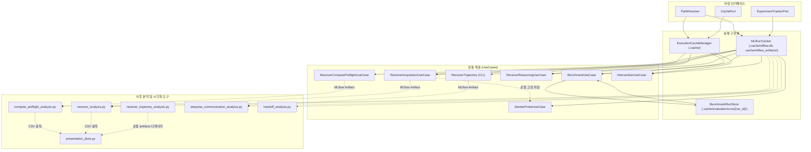
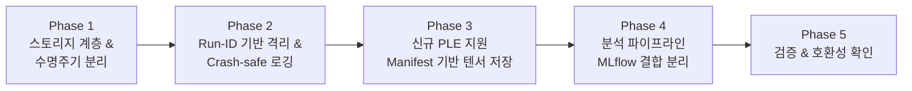

# Storage Policy Architecture Audit Report

- **Target Repository**: `latentmas-storage` (`latentmas-reprop`)
- **Audit Branch**: `ref/storage-policy`
- **Audit Date**: 2026-10-23
- **Auditor**: Antigravity Agentic AI
- **Execution Mode**: Static Analysis & Non-destructive Inspection (Exploration Only)

---

## Executive Summary

본 문서는 `latentmas-storage` 레포지토리의 데이터 저장, 캐시, MLflow 관리 체계 전반을 전수 조사한 아키텍처 감사(Audit) 보고서이다. 기존 실험의 재현성과 데이터 호환성을 100% 보존하면서, 향후 대규모 연구 데이터(단일 개입 실험 `PLE / PLCE / PLPE`) 수용 및 클라우드/외부 스토리지 이전을 지원하기 위한 리팩터링 경계를 도출하는 것을 목적으로 한다.

### 핵심 조사 결과 요약
1. **휘발성 캐시와 영구 데이터의 치명적 결합**:
   - `justfile`의 `clean-cache` 레시피(`rm -rf .cache/`) 실행 시, 기본 MLflow SQLite DB(`.cache/mlflow.db`)와 모든 MLflow 아티팩트(`.cache/mlflow_artifacts/`)가 **영구 삭제**되는 치명적 정책 충돌이 확인되었다.
2. **고정 파일명으로 인한 덮어쓰기(Overwrite) 위험**:
   - `receiver_acquisition` 모듈은 고정 파일명(`sample_results.json`, `sender_latent_states.pt`)을 사용하고 있어, 새 실행 시 이전 실험 데이터가 즉시 손실된다.
   - `intervention` 모듈의 raw KV 텐서 캐시(`latent_{task}_{idx}_s{seed}.pt`)는 모델명과 하이퍼파라미터가 누락되어 이종 모델 실험 간 파일 덮어쓰기가 발생한다.
3. **분석 스크립트와 로컬 디렉터리 경로의 강결합**:
   - `presentation_plots.py`, `receiver_trajectory_analysis.py` 등 주요 분석 스크립트가 `artifacts/` 디렉터리 내 고정된 상대 경로에 강하게 결합되어 있으며, MLflow 기반 단일 진실 공급원(SSOT) 원칙과 괴리가 존재한다.
4. **저장 실패의 침묵(Silent Suppression)**:
   - `benchmark`, `intervention` 등 핵심 use case에서 `contextlib.suppress(Exception)`로 파일 저장을 감싸고 있어, 디스크 용량 부족이나 I/O 실패 시 아무런 경고 없이 데이터가 유실된다.
5. **우수한 패턴의 존재 및 재사용 가능성**:
   - `BenchmarkRunStore`의 결정론적 멱등 재개(resumption), `SavedRunReader`의 엄격한 MLflow 아티팩트 무결성 검증, `compute_sample_key` 기반의 SHA-256 샘플 식별 체계는 완성도가 매우 높아 향후 표준 저장 프레임워크의 기반으로 즉시 재사용할 수 있다.

---

## A. Current Architecture (현재 저장 구조 및 실제 데이터 흐름)

### 1. 경로 관리 체계 (`PathResolver`)
- **구현 파일**: [`src/latentmas_reprop/infrastructure/paths/resolver.py`](file:///home/user3/projects/latentmas-storage/src/latentmas_reprop/infrastructure/paths/resolver.py)
- **관리 경로**:
  - `root`: `pyproject.toml` 또는 `.git` 탐색을 통한 프로젝트 루트 경로. 환경변수 `LATENTMAS_PROJECT_ROOT`로 오버라이드 가능 ([resolver.py#L40-L50](file:///home/user3/projects/latentmas-storage/src/latentmas_reprop/infrastructure/paths/resolver.py#L40-L50)).
  - `cache_dir`: `<root>/.cache` (호출 시 디렉터리 자동 생성 `mkdir(parents=True, exist_ok=True)`) ([resolver.py#L62-L66](file:///home/user3/projects/latentmas-storage/src/latentmas_reprop/infrastructure/paths/resolver.py#L62-L66)).
  - `data_dir`: `<root>/data` ([resolver.py#L75-L78](file:///home/user3/projects/latentmas-storage/src/latentmas_reprop/infrastructure/paths/resolver.py#L75-L78)).
  - `configs_dir`: `<root>/configs` ([resolver.py#L97-L101](file:///home/user3/projects/latentmas-storage/src/latentmas_reprop/infrastructure/paths/resolver.py#L97-L101)).
  - `logs_dir`: `<root>/example_logs` ([resolver.py#L85-L89](file:///home/user3/projects/latentmas-storage/src/latentmas_reprop/infrastructure/paths/resolver.py#L85-L89)).
  - `assets_dir`: `<root>/assets` ([resolver.py#L91-L94](file:///home/user3/projects/latentmas-storage/src/latentmas_reprop/infrastructure/paths/resolver.py#L91-L94)).
- **한계 및 괴리**:
  - 실제 코드베이스에서 널리 사용되는 `artifacts/` 디렉터리에 대한 프로퍼티(`artifacts_dir`)가 `PathResolver`에 정의되어 있지 않음.
  - 분석 스크립트들이 `paths.root / "artifacts"` 또는 상대 경로 `Path("artifacts/...")`를 파편화된 방식으로 생성하여 접근하고 있음.

### 2. 캐시 인터페이스 및 계층 분리 (`CachePort`, `CacheLayer`, `ExecutionCacheManager`)
- **포트 정의**: [`src/latentmas_reprop/domain/ports/cache_port.py`](file:///home/user3/projects/latentmas-storage/src/latentmas_reprop/domain/ports/cache_port.py)
  - `CacheLayer` 열거형([cache_port.py#L7-L19](file:///home/user3/projects/latentmas-storage/src/latentmas_reprop/domain/ports/cache_port.py#L7-L19)):
    - `MODELS = "models"`, `MODELS_REALIGN = "models/realign"`
    - `EVALUATION = "evaluation"`, `EVALUATION_RUNS = "evaluation/runs"`
    - `EVALUATION_INTERVENTIONS = "evaluation/interventions"`
    - `EVALUATION_RECEIVER_ACQUISITION = "evaluation/receiver_acquisition"`
    - `DATASETS = "datasets"`, `RUNTIME = "runtime"`
    - `LATENT_INTERVENTIONS = "latent_interventions"`
    - `LATENT_RECEIVER_ACQUISITION = "latent_receiver_acquisition"`
  - `CachePort` 추상 메서드: `get_layer_path()`, `save_json()`, `load_json()`, `save_torch()`, `load_torch()`, `exists()`
- **인프라 어댑터**: [`src/latentmas_reprop/infrastructure/cache/manager.py`](file:///home/user3/projects/latentmas-storage/src/latentmas_reprop/infrastructure/cache/manager.py)
  - `ExecutionCacheManager`: `CachePort`를 구현하며, 모든 파일 I/O를 `PathResolver.cache_dir`(`.cache/`) 하위로 라우팅.

### 3. 실험 추적 체계 (`ExperimentTrackerPort`, `MLflowTracker`)
- **포트 정의**: [`src/latentmas_reprop/domain/ports/tracking_port.py`](file:///home/user3/projects/latentmas-storage/src/latentmas_reprop/domain/ports/tracking_port.py)
  - `ExperimentTrackerPort`: `start_run()`, `log_params()`, `log_metrics()`, `log_artifact()`, `log_dict()`, `end_run()`, `start_sample_trace()`, `start_span()`, `log_expectation()`, `log_feedback()`, `flush_traces()`
  - `LiveSpanPort`: `MLflowSpanAdapter`를 통해 OpenTelemetry 호환 GenAI Spans/Traces 기록.
- **인프라 어댑터**: [`src/latentmas_reprop/infrastructure/tracking/mlflow_tracker.py`](file:///home/user3/projects/latentmas-storage/src/latentmas_reprop/infrastructure/tracking/mlflow_tracker.py)
  - `MLflowTracker`:
    - `MLFLOW_TRACKING_URI` 미설정 시 기본 로컬 SQLite DB: `sqlite:///<cache_dir>/mlflow.db` ([mlflow_tracker.py#L48-L50](file:///home/user3/projects/latentmas-storage/src/latentmas_reprop/infrastructure/tracking/mlflow_tracker.py#L48-L50)).
    - 로컬 아티팩트 기본 경로: `<cache_dir>/mlflow_artifacts` ([mlflow_tracker.py#L56-L59](file:///home/user3/projects/latentmas-storage/src/latentmas_reprop/infrastructure/tracking/mlflow_tracker.py#L56-L59)).
    - 원격 URI 설정 시(`http://...`): 로컬 아티팩트 강제를 해제하고 원격 서버 정책에 위임.
    - 실행 태그에 `git_commit` 자동 주입 ([mlflow_tracker.py#L75](file:///home/user3/projects/latentmas-storage/src/latentmas_reprop/infrastructure/tracking/mlflow_tracker.py#L75)).

### 4. UseCase별 저장 로직 및 데이터 흐름 상세

#### 4.1. Benchmark UseCase (`src/latentmas_reprop/application/benchmark_use_case.py`)
- **진입점**: `just run -c <preset>` (`src/run/main.py`)
- **실행 흐름**:
  1. `build_run_id(args, dtype_name)`로 모델·태스크·하이퍼파라미터 기반의 결정론적 문자열 식별자 생성 ([identity.py#L35-L49](file:///home/user3/projects/latentmas-storage/src/latentmas_reprop/application/benchmark/identity.py#L35-L49)).
  2. `BenchmarkRunStore(cache_port, run_id)` 초기화 (`.cache/evaluation/runs/{run_id}/`).
  3. `store.has_keys()`로 완료 여부 검사: 이미 완료된 경우 disk에서 로드 후 MLflow 로깅 후 즉시 반환.
  4. 미완료 샘플에 대해 배치 단위 추론 수행.
  5. 매 배치마다 `store.append(stored)`로 `.cache/evaluation/runs/{run_id}/samples.jsonl`에 점진적 추가 (Crash-safe).
  6. 완료 시 `store.write_complete(...)`로 `summary.json` 및 `progress.json` 갱신.
  7. `save_benchmark_artifacts(...)` 호출:
     - `.cache/evaluation/runs/{run_id}.json` 저장 (`contextlib.suppress(Exception)` 처리됨).
     - `.cache/runtime/{run_id}_sample_results.jsonl` 생성 후 `tracker.log_artifact()`로 MLflow 아티팩트에 업로드.
     - `results/summary.json`, `config/resolved_config.yaml`을 MLflow dict로 기록.
     - 샘플별 trace 및 evaluator expectation/feedback 기록.

#### 4.2. Secret-Digit Receiver Acquisition UseCase (`src/latentmas_reprop/application/receiver_acquisition_use_case.py`)
- **진입점**: `just run-acquisition` (`src/run/main.py --acquisition`)
- **실행 흐름**:
  1. 100개 샘플에 대해 sender forward, latent state 수집, receiver context 평가 수행 (전부 인메모리 유지).
  2. 루프 완료 후 `log_receiver_artifacts` 호출 ([receiver_acquisition/artifacts.py#L11-L64](file:///home/user3/projects/latentmas-storage/src/latentmas_reprop/application/receiver_acquisition/artifacts.py#L11-L64)):
     - `.cache/evaluation/receiver_acquisition/sample_results.json` (고정 파일명) 저장.
     - `.cache/evaluation/receiver_acquisition/summary.json` (고정 파일명) 저장.
     - `.cache/evaluation/receiver_acquisition/sample_results.jsonl` (고정 파일명) 생성 후 MLflow 업로드.
     - `save_latent_states` 활성화 시: `.cache/evaluation/receiver_acquisition/sender_latent_states.pt` (고정 파일명, 대용량 텐서) 저장 후 MLflow `probe` 경로로 업로드.
- **취약점**: 중도 실패 시 이전까지의 샘플 결과가 전량 유실되며, 재실행 시 기존 파일이 덮어써짐.

#### 4.3. Sender Probe Analysis UseCase (`src/run/sender_probe.py`)
- **진입점**: `just analyze-sender-probe`
- **입력원**:
  - 모드 A: 로컬 텐서 파일 (`--states .cache/evaluation/receiver_acquisition/sender_latent_states.pt`)
  - 모드 B: MLflow Run ID (`--source-run-id <run_id>`) -> `mlflow.artifacts.download_artifacts`로 임시 디렉터리(`tempfile.TemporaryDirectory`)에 다운로드 후 분석.
- **출력**: `latentmas_sender_probe` 또는 원본 trajectory 실험에 새 Run으로 metrics 및 null statistics JSON 기록.
- **특수 기능**: `--replace-source-run` 옵션 시 레거시 런의 데이터를 복제하여 새 표준 런을 생성하고 레거시 런을 soft-delete ([replacement.py#L90-L100](file:///home/user3/projects/latentmas-storage/src/latentmas_reprop/application/sender_probe/replacement.py#L90-L100)).

#### 4.4. Receiver Trajectory Sweep (`src/run/receiver_trajectory.py`)
- **진입점**: `just run-receiver-trajectory`
- **실행 흐름**:
  1. `tempfile.TemporaryDirectory(prefix="receiver-trajectory-")` 생성.
  2. 모든 산출물(`parity.json`, `sample_results.jsonl`, `sender_latent_states.pt`, `receiver_outputs/*.pt`)을 임시 디렉터리에 작성.
  3. `tracker.log_artifact()`로 MLflow 아티팩트(`latentmas_receiver_trajectory` 실험)에 전량 업로드 ([receiver_trajectory.py#L101-L119](file:///home/user3/projects/latentmas-storage/src/run/receiver_trajectory.py#L101-L119)).
  4. ContextManager 종료와 동시에 로컬 임시 디렉터리 자동 삭제.
- **특징**: 로컬 `.cache/`에 영구 보존 파일을 남기지 않고 순수 MLflow 아티팩트로만 생존함.

#### 4.5. Receiver Reasoning UseCase (`src/latentmas_reprop/application/receiver_reasoning_use_case.py`)
- **진입점**: `just run-receiver-reasoning`
- **실행 흐름**:
  1. `stem = build_run_stem("receiver_reasoning", task, model, n_samples)`로 타임스탬프 기반 고유 디렉터리 생성: `.cache/evaluation/runs/{stem}/` ([receiver_reasoning_use_case.py#L63-L68](file:///home/user3/projects/latentmas-storage/src/latentmas_reprop/application/receiver_reasoning_use_case.py#L63-L68)).
  2. 샘플마다 `sample_results.jsonl`에 점진적 추가 (Crash-safe).
  3. 예외 또는 KeyboardInterrupt 발생 시 `failure.json`을 작성하고 부분 `sample_results.jsonl`을 MLflow에 아티팩트로 업로드 후 종료.
  4. 정상 완료 시 `summary.json`, `resolved_config.yaml` 작성 및 MLflow 업로드.

#### 4.6. Receiver Compute Preflight UseCase (`src/latentmas_reprop/application/receiver_compute_preflight_use_case.py`)
- **진입점**: `just run-receiver-compute-preflight`
- **실행 흐름**:
  1. `CachePort`를 사용하지 않고 순수 `tempfile.TemporaryDirectory(prefix="receiver-compute-")` 사용 ([receiver_compute_preflight_use_case.py#L85](file:///home/user3/projects/latentmas-storage/src/latentmas_reprop/application/receiver_compute_preflight_use_case.py#L85)).
  2. `sample_results.jsonl` 점진적 작성.
  3. 성공/실패 여부와 관계없이 임시 디렉터리 내의 모든 파일(`sample_results.jsonl`, `trace_manifest.json`, `collection_summary.json` 또는 `failure.json`)을 MLflow 아티팩트 `results/`로 업로드.
  4. 종료 시 임시 디렉터리 삭제.

#### 4.7. Latent Intervention UseCase (`src/latentmas_reprop/application/intervention_use_case.py`)
- **진입점**: `just run-intervention`
- **실행 흐름**:
  1. 1단계: `build_intervention_contexts`에서 latent context 빌드. `--save_raw_cache` 플래그 활성화 시 `.cache/latent_interventions/latent_{task}_{idx}_s{seed}.pt`로 텐서 저장 ([context_builder.py#L46-L51](file:///home/user3/projects/latentmas-storage/src/latentmas_reprop/application/intervention/context_builder.py#L46-L51), `contextlib.suppress(Exception)` 처리됨).
  2. 2단계: 4가지 조건(own, cross, drop, zero) 디코딩 수행 (결과는 메모리에 누적).
  3. 완료 시 `save_intervention_artifacts` 호출:
     - `.cache/evaluation/interventions/{run_stem}.json` 저장.
     - `.cache/runtime/{run_stem}_*.json` 생성 및 MLflow 업로드.

#### 4.8. 사후 분석 및 시각화 도구 (`src/run/*_analysis.py`, `src/run/*_plots.py`)
- `handoff_analysis.py`: MLflow에서 `--version-tag`로 검색 후 아티팩트를 다운로드하여 `artifacts/latent_handoff/`에 보고서 생성 ([handoff_analysis.py#L24](file:///home/user3/projects/latentmas-storage/src/run/handoff_analysis.py#L24)).
- `compute_preflight_analysis.py`: MLflow에서 모델명/Run ID로 검색 후 아티팩트를 다운로드하여 `artifacts/receiver_compute_preflight/<model_name>/`에 CSV/플롯 저장 ([compute_preflight_analysis.py#L140](file:///home/user3/projects/latentmas-storage/src/run/compute_preflight_analysis.py#L140)).
- `presentation_plots.py`: MLflow에 접근하지 않고, 로컬의 `artifacts/receiver_acquisition` 및 `artifacts/receiver_compute_preflight`에서 CSV를 직접 읽어 `artifacts/presentation/`에 최종 논문/발표용 PNG/PDF 생성 ([presentation_plots.py#L220-L230](file:///home/user3/projects/latentmas-storage/src/run/presentation_plots.py#L220-L230)).
- `receiver_trajectory_analysis.py`: 로컬의 `artifacts/receiver_trajectory/<model_name>/` 디렉터리 존재를 직접 가정하고 CSV를 분석 ([receiver_trajectory_analysis.py#L29-L37](file:///home/user3/projects/latentmas-storage/src/run/receiver_trajectory_analysis.py#L29-L37)).
- `stepwise_communication_analysis.py`: `SavedRunReader`를 통해 MLflow Run ID에서 아티팩트를 직접 검증 및 다운로드하여 분석 ([stepwise_communication_sources.py#L25-L36](file:///home/user3/projects/latentmas-storage/src/run/stepwise_communication_sources.py#L25-L36)).

---

## B. Storage Inventory (저장 대상 전수 인벤토리)

| 데이터 대상 | 생산자 (Producer) | 소비자 (Consumer) | 형식 | 실제 저장 위치 | 식별자 및 파일명 규칙 | MLflow Run ID 연결 방식 | 보존/삭제/덮어쓰기 정책 | 동일 설정 재실행 시 동작 | 중도 실패 시 동작 | 재생성 가능 여부 | 타 머신 이식성 |
| :--- | :--- | :--- | :--- | :--- | :--- | :--- | :--- | :--- | :--- | :--- | :--- |
| **Realignment Matrix** | `ModelWrapper` (`realignment.py`) | `ModelWrapper` | PyTorch `.pt` | `.cache/models/realign/` | `{model_hash}_realign.pt` | 직접 연결 없음 (Config 파라미터로 추적) | 영구 캐시 / 수동 삭제 | 파일 존재 시 계산 스킵 및 즉시 재사용 | 미완료 시 파일 미생성 (안전) | 완전 결정론적 재생성 가능 | 동일 모델 가중치 환경에서 복사 가능 |
| **Benchmark Sample Logs** | `BenchmarkUseCase` (`store.py`) | `BenchmarkRunStore`, `BenchmarkUseCase` | JSONL | `.cache/evaluation/runs/{run_id}/samples.jsonl` | `build_run_id(args, dtype)` (결정론적 파라미터 조합) | MLflow Run name/tags와 파라미터로 매핑 (직접 tag 없음) | 보존 / 동일 키는 append 방지 (멱등) | 이미 완료된 샘플 스킵, 부족분만 추가 실행 | 이미 기록된 라인은 보존 (Dirty line 자동 복구) | 동일 seed/환경 시 결정론적 재생성 가능 | 파일 복사 시 즉시 재사용 가능 |
| **Benchmark Run Summary** | `BenchmarkUseCase` (`store.py`) | `BenchmarkUseCase` | JSON | `.cache/evaluation/runs/{run_id}/summary.json` | 고정명 `summary.json` | 상동 | 원자적 덮어쓰기 (`.tmp` -> replace) | 기존 결과 재사용 | 완료 전까지 미생성 | 재생성 가능 | 이식 가능 |
| **Benchmark Run Monolith** | `BenchmarkUseCase` (`artifacts.py`) | 레거시 분석 스크립트 | JSON | `.cache/evaluation/runs/{run_id}.json` | `{run_id}.json` | 상동 | 덮어쓰기 (`suppress(Exception)`) | 덮어씀 | 미생성 (유실) | 재생성 가능 | 이식 가능 |
| **Acquisition Results (Local)** | `ReceiverAcquisitionUseCase` | `sender_probe.py`, `receiver_analysis.py` | JSON / JSONL | `.cache/evaluation/receiver_acquisition/` | `sample_results.json`, `sample_results.jsonl` (고정명) | 연결 없음 (로컬 파일명에 Run ID 부재) | **새 실행마다 강제 덮어쓰기 (위험)** | **이전 실험 결과 전량 덮어씀** | **중도 실패 시 전량 유실** | 동일 seed 시 재생성 가능 | 파일 복사 시 이식 가능하나 메타데이터 분리 |
| **Acquisition Sender States** | `ReceiverAcquisitionUseCase` | `sender_probe.py` | PyTorch `.pt` (대용량) | `.cache/evaluation/receiver_acquisition/sender_latent_states.pt` | `sender_latent_states.pt` (고정명) | MLflow artifact `probe/`로 업로드되어 링크 | **새 실행마다 강제 덮어쓰기 (위험)** | **이전 텐서 전량 덮어씀** | **중도 실패 시 전량 유실** | 모델 inference 재수행 필요 | 가중치/PyTorch 버전 일치 시 이식 가능 |
| **Intervention Raw KV Cache** | `InterventionUseCase` (`context_builder.py`) | 없음 (디버깅/검증용) | PyTorch `.pt` (대용량) | `.cache/latent_interventions/` | `latent_{task}_{idx}_s{seed}.pt` (모델명 누락) | MLflow에 미등록 (완전 로컬 고립) | **이종 모델 실행 시 덮어쓰기 발생 (위험)** | 덮어씀 (`suppress(Exception)`) | 생성된 인덱스까지만 디스크에 잔류 | inference 재수행 필요 | 디바이스/dtype 호환 필요 |
| **Intervention Results** | `InterventionUseCase` (`artifacts.py`) | 분석 스크립트 | JSON / JSONL | `.cache/evaluation/interventions/` 및 `.cache/runtime/` | `{stem}.json`, `{stem}_sample_results.jsonl` (타임스탬프) | MLflow Run tags(`experiment_type=intervention`) | 보존 (타임스탬프 기반 고유 파일) | 타임스탬프가 달라 별도 파일 생성 | 중도 실패 시 디스크 미작성 | 재생성 가능 | 이식 가능 |
| **Receiver Reasoning Logs** | `ReceiverReasoningUseCase` | `handoff_analysis.py` | JSONL / JSON | `.cache/evaluation/runs/{stem}/` | `{stem}/sample_results.jsonl`, `summary.json` (타임스탬프) | MLflow Run Name = `{stem}`, tags = `version_tag` | 보존 | 새 디렉터리 생성 | `failure.json` 작성 및 부분 JSONL MLflow 보존 | 재생성 가능 | 이식 가능 |
| **MLflow SQLite Database** | `MLflowTracker` | MLflow Client / UI, 모든 분석 스크립트 | SQLite `.db` | `.cache/mlflow.db` | 단일 SQLite DB 파일 | 진실 공급원 (SSOT) | **`clean-cache` 시 완전 삭제 (치명적)** | 트랜잭션 추가 누적 | 트랜잭션 rollback 또는 FAILED run 상태 기록 | 불가능 (실험 이력 영구 소실) | DB 파일 통째로 복사 시 이식 가능 |
| **MLflow Artifacts Store** | `MLflowTracker` | MLflow Client, 모든 분석 스크립트 | 디렉터리 트리 | `.cache/mlflow_artifacts/<exp_id>/<run_id>/` | MLflow 내부 UUID 및 경로 | Run ID 기반 디렉터리 격리 | **`clean-cache` 시 완전 삭제 (치명적)** | 격리된 새 Run 디렉터리 생성 | 기록 도중 중단된 artifact만 잔류 | 불가능 (아티팩트 영구 소실) | 전체 디렉터리 복사 및 DB 경로 보정 필요 |
| **Analysis Published Reports** | 분석 스크립트 (`src/run/*_analysis.py`) | `presentation_plots.py`, 사용자 | CSV, MD, JSON, PNG | `artifacts/<subsystem>/` | `<subsystem>/summary.md`, `<model>/budget_curves.csv` | `source.json` 내 `run_id` 필드로 링크 | 수동 관리 / 스크립트 재실행 시 덮어쓰기 | 동일 모델 대상 재실행 시 덮어씀 | 미완료 시 불완전 파일 잔류 가능 | MLflow 아티팩트로부터 100% 무인퍼런스 재생성 가능 | Git 또는 압축 전송으로 완전 이식 가능 |

---

## C. Policy Conflicts & Risk Analysis (정책 충돌 및 위험 분석)

### 1. `.cache/` 삭제가 MLflow DB 및 영구 보존 데이터에 미치는 치명적 영향
- **문제 확인 (Fact)**:
  - [`justfile` L88-89](file:///home/user3/projects/latentmas-storage/justfile#L88-L89):
    ```makefile
    clean-cache:
        rm -rf .cache/
    ```
  - [`mlflow_tracker.py` L48-59](file:///home/user3/projects/latentmas-storage/src/latentmas_reprop/infrastructure/tracking/mlflow_tracker.py#L48-L59):
    ```python
    db_path = self.resolver.cache_dir / "mlflow.db"
    self.tracking_uri = f"sqlite:///{db_path.resolve()}"
    self.artifact_location = str((self.resolver.cache_dir / "mlflow_artifacts").resolve())
    ```
- **발생 조건**: 사용자가 임시 캐시를 비우기 위해 `just clean-cache`를 실행할 때.
- **영향 및 위험도**: **CRITICAL (데이터 영구 손실)**.
  - 실험의 진실 공급원(SSOT)인 MLflow DB와 모든 추적 아티팩트가 증발함.
  - 문서([`docs/cache_and_paths.md` L50-54](file:///home/user3/projects/latentmas-storage/docs/cache_and_paths.md#L50-L54))에서는 "non-HuggingFace run caches and realignment matrices"만 청소된다고 명시하여 사용자를 오도하고 있음.

### 2. 고정 파일명으로 인한 산출물 덮어쓰기 충돌
- **문제 확인 (Fact)**:
  - `receiver_acquisition` 모듈([`artifacts.py` L23-61](file:///home/user3/projects/latentmas-storage/src/latentmas_reprop/application/receiver_acquisition/artifacts.py#L23-L61)):
    - `.cache/evaluation/receiver_acquisition/sample_results.json`
    - `.cache/evaluation/receiver_acquisition/summary.json`
    - `.cache/evaluation/receiver_acquisition/sender_latent_states.pt`
  - `intervention` raw cache([`context_builder.py` L47](file:///home/user3/projects/latentmas-storage/src/latentmas_reprop/application/intervention/context_builder.py#L47)):
    - `cache_name = f"latent_{task}_{idx}_s{seed}.pt"` (모델명, 레이어, 스텝 정보 없음).
  - `compute_preflight_analysis`([`compute_preflight_analysis.py` L140](file:///home/user3/projects/latentmas-storage/src/run/compute_preflight_analysis.py#L140)):
    - `Path("artifacts/receiver_compute_preflight") / model_dir` (Run ID 없이 모델명만으로 디렉터리 구성).
- **발생 조건**:
  - 서로 다른 모델(예: 0.6B 실행 후 8B 실행)로 acquisition 또는 intervention 실험을 순차 실행할 때.
  - 동일 모델에 대해 새로운 설정을 시도하고 재분석할 때.
- **영향 및 위험도**: **HIGH (데이터 파괴적 덮어쓰기)**.
  - 이전 실험의 로컬 텐서와 결과 파일이 소리 없이 삭제/대체됨.

### 3. MLflow Artifact와 로컬 파일 분리 및 접근 불가 위험
- **문제 확인 (Fact)**:
  - `receiver_trajectory.py` 및 `receiver_compute_preflight_use_case.py`는 `tempfile.TemporaryDirectory`에서 작업 후 MLflow로만 업로드하고 로컬 디렉터리를 삭제함.
  - 반면, `receiver_trajectory_analysis.py`([L29-L34](file:///home/user3/projects/latentmas-storage/src/run/receiver_trajectory_analysis.py#L29-L34))는 로컬 `artifacts/receiver_trajectory/<model_name>/` 디렉터리가 이미 존재할 것으로 기대함.
- **발생 조건**: 사용자가 `just run-receiver-trajectory` 실행 후 `just analyze-receiver-trajectory`를 실행할 때.
- **영향 및 위험도**: **HIGH (파이프라인 단절 및 실행 실패)**.
  - MLflow에만 아티팩트가 있고 로컬 `artifacts/` 폴더에는 파일이 다운로드되어 있지 않아 `FileNotFoundError: No collected receiver trajectories found` 발생.
  - 사용자가 수동으로 MLflow에서 다운로드하여 특정 디렉터리에 넣지 않는 한 스크립트 실행 불가.

### 4. 분석 코드의 특정 디렉터리 및 파일명 강결합
- **문제 확인 (Fact)**:
  - `presentation_plots.py`([L220-L230](file:///home/user3/projects/latentmas-storage/src/run/presentation_plots.py#L220-L230)):
    - `artifacts/receiver_acquisition/sender_probe_cells.csv`
    - `artifacts/receiver_acquisition/receiver_conditions.csv`
    - `artifacts/receiver_compute_preflight/Qwen_Qwen3-4B/budget_curves.csv`
    - `artifacts/receiver_compute_preflight/Qwen_Qwen3-14B/budget_curves.csv`
- **발생 조건**: 분석 실행 시 파일명이나 경로를 임의 변경하거나 하위 폴더 구조가 달라지는 경우.
- **영향 및 위험도**: **MEDIUM (유연성 부재 및 배포 경직성)**.
  - 스토리지 구조를 변경할 때 해당 파일 경로를 하드코딩한 모든 스크립트가 일괄 수정되어야 함.

### 5. 불필요한 이중/삼중 중복 저장
- **문제 확인 (Fact)**:
  - `receiver_acquisition`의 500MB~1GB 단위 대용량 텐서(`sender_latent_states.pt`, `receiver_hidden_states.pt`):
    1. 로컬 `.cache/evaluation/receiver_acquisition/`에 저장.
    2. MLflow tracker에 의해 `.cache/mlflow_artifacts/<exp_id>/<run_id>/probe/`로 전체 복사됨.
  - `receiver_reasoning`:
    1. `.cache/evaluation/runs/{stem}/sample_results.jsonl`
    2. MLflow 아티팩트로 복사.
    3. `handoff_analysis` 실행 시 `.cache/receiver_reasoning/mlflow/{run_id}/`로 3차 다운로드 복제.
- **영향 및 위험도**: **MEDIUM (로컬 디스크 공간 낭비)**.
  - 모델 규모(4B, 8B, 14B)가 커질수록 텐서 용량이 수십~수백 GB에 달해 로컬 디스크 고갈 유발.

### 6. 실패한 실행에서의 유효 부분 결과 손실 (Partial Results Loss)
- **문제 확인 (Fact)**:
  - `receiver_acquisition`과 `intervention`은 인메모리 리스트에만 결과를 모아두고 루프 완료 후에만 `save_*` 함수를 호출함.
  - 100개 샘플 중 95번째에서 CUDA OOM이나 타임아웃 발생 시 1~94번째 샘플의 추론 결과가 완전히 소멸됨.
  - 반면 `benchmark`(`BenchmarkRunStore`)와 `receiver_reasoning`, `receiver_compute_preflight`는 샘플/배치 단위로 JSONL에 실시간 flush하여 부분 결과를 완벽히 보존함.
- **영향 및 위험도**: **HIGH (컴퓨팅 자원 낭비)**.
  - 고비용 LLM 추론 시 실패 복구 불가능.

### 7. 저장 실패의 무조건적 침묵 (Silent Exception Suppression)
- **문제 확인 (Fact)**:
  - `benchmark/artifacts.py` [L168-L176](file:///home/user3/projects/latentmas-storage/src/latentmas_reprop/application/benchmark/artifacts.py#L168-L176):
    ```python
    with contextlib.suppress(Exception):
        cache_port.save_json(...)
    ```
  - `intervention/artifacts.py` [L141-L149](file:///home/user3/projects/latentmas-storage/src/latentmas_reprop/application/intervention/artifacts.py#L141-L149):
    ```python
    with contextlib.suppress(Exception):
        cache_port.save_json(...)
    ```
  - `intervention/context_builder.py` [L48-L51](file:///home/user3/projects/latentmas-storage/src/latentmas_reprop/application/intervention/context_builder.py#L48-L51):
    ```python
    with contextlib.suppress(Exception):
        cache_port.save_torch(CacheLayer.LATENT_INTERVENTIONS, cache_name, past_kv_cpu)
    ```
  - `mlflow_tracker.py` [L217, L241](file:///home/user3/projects/latentmas-storage/src/latentmas_reprop/infrastructure/tracking/mlflow_tracker.py#L217): `log_expectation`, `log_feedback`의 `except Exception: pass`.
- **발생 조건**: 디스크 용량 부족(ENOSPC), 파일 권한 오류(EACCES), serialization 에러 발생 시.
- **영향 및 위험도**: **HIGH (장애 인지 불가)**.
  - 저장이 실패했음에도 프로세스는 에러 없이 0으로 종료되어, 사용자는 결과가 안전하게 기록된 것으로 착각하게 됨.

### 8. 실험 추적성(Traceability) 결손
- **문제 확인 (Fact)**:
  - `BenchmarkUseCase`: 로컬 디스크에는 결정론적 `run_id`(`.cache/evaluation/runs/{run_id}`)로 저장되지만, MLflow에 생성되는 Run Name은 단순 `{model}_{task}_{method}`이며 파라미터 기반 `run_id`가 MLflow의 태그나 파라미터로 명시 등록되지 않음.
  - `InterventionUseCase`: 로컬 디스크에는 타임스탬프가 포함된 `run_stem`으로 저장되지만, MLflow Run Name은 고정된 `{model}_{task}_intervention`이며 `run_stem`이 태그로 연결되지 않음.
- **영향 및 위험도**: **MEDIUM (MLflow와 로컬 저장소 간의 1:1 역추적 곤란)**.

---

## D. Dependency Map (의존성 및 영향도 분석)



### 테스트 스위트 영향도 분석
현재 275개 단위/통합 테스트 중 스토리지 정책 변경 시 직접 영향받는 테스트:
- `tests/test_paths.py` (5개 테스트): `PathResolver` 프로퍼티 계약 검증.
- `tests/test_cache.py` (3개 테스트): `ExecutionCacheManager` 계층 및 I/O 검증.
- `tests/test_mlflow_tracker.py` (7개 테스트): 로컬 SQLite DB 경로 및 아티팩트 경로 검증.
- `tests/test_benchmark_resume.py` (6개 테스트): `BenchmarkRunStore` 및 `build_run_id` 계약 검증.
- `tests/test_benchmark_tracking.py` (4개 테스트): MLflow benchmark 파라미터 및 span 검증.
- `tests/test_handoff_analysis.py` (13개 테스트): MLflow run 로딩 및 캐시 다운로드 검증.
- `tests/test_receiver_compute_collection.py` (2개 테스트) & `test_receiver_compute_trajectory.py` (10개 테스트): MLflow 추적 및 manifest 검증.
- `tests/test_stepwise_communication_sources.py` (17개 테스트): `SavedRunReader` 아티팩트 검증.

> [!IMPORTANT]
> `PathResolver`나 `MLflowTracker`의 기본 경로를 수정할 때, 기존 테스트들의 expectation(`tmp_path / ".cache/mlflow.db"` 등)과의 하위 호환성을 반드시 보장해야 한다.

---

## E. Refactoring Boundary (리팩터링 경계 정의)

### 1. 반드시 수정해야 할 부분 (Must Fix)
1. **스토리지 수명주기 분리 (Lifecycle Partitioning)**:
   - 영구 연구 데이터(MLflow DB, MLflow artifacts, 외부 대용량 텐서)를 `.cache/` 외부로 분리.
   - 예: 레포지토리 루트의 `.mlflow/` 또는 `storage/` 디렉터리로 분리하거나, `PathResolver`에 영구 스토리지 경로(`storage_dir`)를 신설.
2. **`clean-cache` 레시피의 안전한 범위 재정의**:
   - `rm -rf .cache/` 대신, 순수 임시 캐시(재정렬 행렬, 런타임 스크래치 등)만 선별 삭제하도록 변경하거나 MLflow DB 및 영구 아티팩트가 삭제 대상에 포함되지 않도록 원천 격리.
3. **고정 파일명 해소 및 Run ID 기반 네이밍 적용**:
   - `receiver_acquisition`의 `sample_results.json`, `sender_latent_states.pt` 등을 `{run_id}_sample_results.json` 또는 `{run_id}/` 하위 디렉터리 구조로 전환.
   - `intervention`의 raw cache를 `latent_{task}_{model}_{seed}_{idx}.pt`로 수정하여 모델 간 덮어쓰기 방지.
4. **저장 실패 시 침묵(Silence) 제거**:
   - `contextlib.suppress(Exception)`를 제거하고, 명시적인 예외 로깅(`logger.error`) 및 필수 저장 단계에서는 예외를 재발생시켜 데이터 유실을 조기 발견하도록 수정.
5. **`PathResolver`에 공식 영구 디렉터리 프로퍼티 등록**:
   - `artifacts_dir` (`<root>/artifacts`) 및 `storage_dir` (`<root>/storage`) 프로퍼티를 공식 제공하여 상대 경로 하드코딩 제거.

### 2. 기존 구현을 적극 재사용할 부분 (Reuse)
1. **`BenchmarkRunStore`의 구조와 알고리즘**:
   - 점진적 append, dirty line 자동 복구, completed keys 검사, 원자적 summary 작성(`summary.json.tmp` -> replace) 로직은 가장 완성도 높은 저장 모델임.
   - 향후 `receiver_acquisition`, `intervention`, 신규 `PLE` 실험의 점진적 저장 표준으로 그대로 차용.
2. **식별자 체계**:
   - `compute_sample_key`: `sha256(f"{task}:{split}:{question}".encode()).hexdigest()[:16]` 방식은 데이터셋 및 분할 간 충돌 없는 최고 수준의 결정론적 키이므로 전 실험 표준으로 유지.
   - `build_run_id`: 하이퍼파라미터 정규화를 통한 run 식별 체계 유지.
3. **`SavedRunReader` 및 MLflow Tracking/Tracing 인터페이스**:
   - `MLflowSpanAdapter`, GenAI Spans, Expectation/Feedback assessment 체계 유지.
   - `SavedRunReader`의 엄격한 provenance 추적 및 아티팩트 스키마 검증 로직 재사용.

### 3. 수정하지 않아야 할 부분 (Do Not Modify)
1. **도메인 핵심 로직 및 모델**:
   - `src/latentmas_reprop/domain/models/` (`ProblemSample`, `AgentTrace`, `BenchmarkMetrics`, `InterventionMetrics` 등).
   - `src/latentmas_reprop/domain/services/` (`LatentMASMethod`, `TextMASMethod`, `BaselineMethod`, `prompts`).
2. **모델 추론 및 서빙 인프라**:
   - `ModelWrapper`, `vLLMService`, KV cache 조작 및 forward 로직.
3. **데이터셋 로더 및 평가기**:
   - `src/latentmas_reprop/infrastructure/datasets/` 및 `evaluators/`.

### 4. 마이그레이션 및 하위 호환성이 필요한 부분 (Migration & Compatibility)
1. **기존 MLflow DB 경로 하위 호환**:
   - 만약 MLflow DB 기본 위치를 `.cache/mlflow.db`에서 `storage/mlflow.db`로 이전할 경우:
     - 기존 `.cache/mlflow.db`가 존재하면 이를 우선 읽거나 자동 마이그레이션하는 fallback 로직 유지.
     - `test_mlflow_tracker_local_default` 등 기존 테스트의 assertion을 깨뜨리지 않도록 설정 오버라이드 지원.
2. **분석 도구의 로컬 `artifacts/` 경로 호환**:
   - `presentation_plots.py`가 요구하는 입력 CSV 파일명 및 구조(`artifacts/receiver_acquisition/...`)를 변경하지 않고 유지.

---

## F. Proposed Execution Plan (단계별 리팩터링 계획)

전체 시스템을 파괴적으로 재설계하는 대신, 기존 인프라를 활용하여 5단계로 점진적 리팩터링을 수행한다.



### Phase 1: 스토리지 계층 및 수명주기 분리 (Storage Hierarchy Separation)
- **목표**: `.cache/` 청소 시 MLflow 데이터 및 영구 연구 산출물이 파괴되지 않도록 디렉터리 격리.
- **작업 내용**:
  1. `PathResolver`에 `artifacts_dir` (`<root>/artifacts`) 및 `storage_dir` (`<root>/storage`) 추가.
  2. `MLflowTracker`의 기본 저장소를 `.cache/mlflow.db`에서 `storage/mlflow.db` (및 `storage/mlflow_artifacts/`)로 이전하되, 기존 `.cache/mlflow.db` 탐색 fallback 제공.
  3. `justfile`의 `clean-cache`를 안전하게 수정: `.cache/` 내의 순수 휘발성 레이어(`models/realign`, `runtime`)만 삭제하거나 영구 디렉터리를 보호.
  4. `justfile`의 `mlflow-ui` 레시피의 기본 경로 동기화.
- **검증 기준**:
  - `just test` 통과.
  - `just clean-cache` 실행 후에도 `mlflow.db` 및 기존 실험 이력이 온전히 보존됨을 확인.

### Phase 2: Run ID 기반 격리 및 Crash-Safe 점진적 로깅 표준화
- **목표**: 고정 파일명으로 인한 덮어쓰기 위험 제거 및 중도 실패 시 데이터 유실 방지.
- **작업 내용**:
  1. `receiver_acquisition`에 `BenchmarkRunStore`와 동일한 점진적 JSONL append 구조 도입.
  2. `sample_results.json`, `sender_latent_states.pt` 파일명에 `{run_id}` 또는 타임스탬프 스템 주입.
  3. `intervention`의 raw cache 파일명에 `model_name`과 하이퍼파라미터 포함: `latent_{task}_{model}_{seed}_{idx}.pt`.
  4. 파일 I/O 구문의 `contextlib.suppress(Exception)`를 제거하고 명시적 에러 로깅 도입.
- **검증 기준**:
  - 동일 설정 및 이종 모델 2회 연속 실행 시 파일 덮어쓰기 없이 독립적으로 보존됨을 확인.
  - 중간 강제 종료(SIGINT) 시에도 직전 샘플까지의 데이터가 디스크에 유효하게 기록됨을 확인.

### Phase 3: 신규 PLE / PLCE / PLPE 지원을 위한 Manifest 기반 대용량 텐서 저장소 구축
- **목표**: 향후 수십 GB 규모의 KV snapshot 및 hidden state를 MLflow DB 비대화 없이 안전하게 보존.
- **작업 내용**:
  1. `storage/tensors/{run_id}/` 구조 정의.
  2. MLflow에는 대용량 텐서 원본 대신 메타데이터와 체크섬을 포함한 `tensor_manifest.json`을 artifact로 기록.
     - Manifest 내용: sample_key, step, layer, tensor_shape, dtype, sha256_hash, relative_file_path.
  3. 텐서 무결성 검증 유틸리티(`verify_tensor_manifest`) 구현.
- **검증 기준**:
  - 대용량 텐서가 MLflow SQLite 파일 크기를 증가시키지 않고 로컬 지정 경로에 온전히 저장됨.
  - Run ID만으로 Manifest를 통해 모든 텐서를 정확히 인덱싱하고 무결성을 검증할 수 있음.

### Phase 4: 사후 분석 도구의 단일 진실 공급원(SSOT) 정렬 및 다운로더 통일
- **목표**: 로컬 폴더 하드코딩 탈피, MLflow 기반 다운로드 인터페이스 일원화.
- **작업 내용**:
  1. `SavedRunReader` 패턴을 `compute_preflight_analysis`, `receiver_trajectory_analysis` 등으로 확대 적용.
  2. 로컬에 아티팩트가 없을 경우 MLflow에서 자동 다운로드하여 캐싱 후 분석하도록 파이프라인 정류.
  3. `presentation_plots.py`는 기존 하위 호환을 유지하도록 입력 경로 오버라이드 지원 유지.
- **검증 기준**:
  - 로컬 `artifacts/` 폴더를 전부 비운 상태에서도 MLflow Run ID 전달만으로 모든 분석 및 플롯 생성이 정상 동작함을 확인.

### Phase 5: 종합 회귀 검증 및 문서 동기화
- **목표**: 전체 테스트 및 린트 통과, 기존 레시피 동작 보장, 문서 최신화.
- **작업 내용**:
  1. `just lint && just test` 전체 통과.
  2. `docs/cache_and_paths.md`, `docs/architecture.md`, `README.md`에 수정된 저장 정책 및 경로 체계 반영.
- **검증 기준**:
  - 린트 경고 0건, 275개 이상 전체 테스트 100% 통과.

---

## G. Support Feasibility for Future Research Data (PLE / PLCE / PLPE)

향후 단일 개입 연구에서 수집될 신규 데이터 유형에 대해 현 저장 구조의 수용 능력을 6대 요구사항 기준으로 평가한다.

### 1. 신규 데이터 항목 정의
- **Common Latent 구간 hidden states**: `(steps, seq_len, hidden_dim)` (BF16, 샘플당 수십 MB)
- **분기 직전 전체 KV snapshot**: `(2, layers, heads, seq_len, head_dim)` (BF16, 샘플당 수백 MB~수 GB)
- **각 분기(개입/명시 구간) hidden states**: `(branch_count, steps, seq_len, hidden_dim)`
- **Token IDs, positions, masks, execution metadata**: JSON/JSONL (수 KB)
- **생성 trace와 평가 결과**: JSONL 및 MLflow GenAI spans (수 KB)

### 2. 요구사항별 수용성 평가

| 요구사항 | 현재 상태 | 신규 요구사항 수용 가능성 | 필요 조치 및 아키텍처 제언 |
| :--- | :--- | :--- | :--- |
| **1. MLflow를 실험 추적 기준 시스템(SSOT)으로 유지** | 우수 (파라미터, 메트릭, 태그, Traces, Spans가 충실히 구현됨) | **가능 (High)** | MLflow는 run 메타데이터, 평가 결과, trace 기록 및 아티팩트 manifest 등록의 SSOT로 유지. |
| **2. 대용량 텐서의 별도 로컬 저장소 보존** | 취약 (대용량 텐서가 MLflow artifacts 디렉터리로 통째로 복사되어 용량 급증) | **수정 필요 (Medium)** | 대용량 KV snapshot과 hidden state는 MLflow artifact 업로드(`log_artifact`) 대상에서 제외하고, 전용 텐서 스토리지(`storage/tensors/{run_id}/`)에 보존. |
| **3. 캐시와 영구 연구 데이터의 수명주기 분리** | 미흡 (`clean-cache` 시 MLflow DB 및 아티팩트까지 삭제됨) | **수정 필요 (High)** | 휘발성 실행 캐시(`.cache/`)와 영구 연구 데이터(`storage/`, `artifacts/`)의 물리적 디렉터리 분리 필수. |
| **4. Run ID를 통한 모든 데이터 조회** | 부분 지원 (일부 모듈에서 고정 파일명 사용으로 Run ID 유실) | **가능 (High)** | 모든 텐서 및 로그 파일 경로에 `{run_id}`를 네임스페이스로 강제하여, Run ID만으로 로컬/원격 데이터를 100% 조회할 수 있게 함. |
| **5. Manifest 기반 파일 참조와 무결성 검증** | 미구현 (직접 파일 경로 또는 단순 artifact 다운로드만 수행) | **신규 도입 필요 (High)** | `tensor_manifest.json`을 작성하여 각 텐서의 shape, dtype, sha256 해시를 기록하고, 로딩 시 자동 검증하는 Loader 어댑터 구현. |
| **6. 향후 외부 스토리지(S3/NFS) 이전 시 분석 인터페이스 유지** | 구조적 기반 충분 (`SavedRunReader` 및 `PathResolver` 추상화 존재) | **가능 (High)** | `SavedRunReader`와 같은 아티팩트 다운로더/로더 인터페이스 뒤로 물리적 스토리지(로컬, S3, GCS)를 은닉하면 사후 분석 스크립트 수정 없이 이전 가능. |

---

## Conclusion & Recommendations

감사 결과, 현재 저장소는 헥사고날 아키텍처와 MLflow Tracing, 그리고 `BenchmarkRunStore`와 같은 수준 높은 재개(resumption) 메커니즘을 보유하고 있어 기반 구조는 매우 탄탄하다. 

그러나 **1) 휘발성 `.cache/`와 영구 보존 MLflow 데이터의 혼재**, **2) 일부 UseCase의 고정 파일명 덮어쓰기**, **3) 대용량 텐서의 무분별한 복제로 인한 용량 비대화**, **4) 분석 도구의 하드코딩된 로컬 경로 결합**이라는 명확한 위험 요인이 상존한다.

본 보고서에서 제시한 **Phase 1 (스토리지 분리) -> Phase 2 (Run ID 격리) -> Phase 3 (Manifest 기반 텐서 저장) -> Phase 4 (분석 도구 정류) -> Phase 5 (회귀 검증)**의 5단계 최소 리팩터링 계획을 순차 적용할 것을 권장한다.
