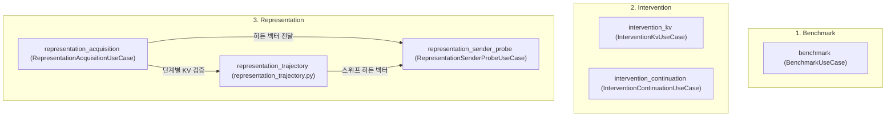

# Application Use Cases Index

이 문서는 LatentMAS Reprop 프로젝트의 애플리케이션 계층(`src/latentmas_reprop/application/`) 및 실행 계층(`src/run/`)에 정의된 **6대 핵심 유스케이스(Use Cases)**와 각 유스케이스별 상세 기술 명세 문서의 색인입니다.

모든 유스케이스는 **헥사고날 아키텍처(Hexagonal Architecture)**의 포트(Ports)와 도메인 모델/서비스를 조합하여 구체적인 연구 및 실험 워크플로를 오케스트레이션합니다.

---

## 📌 유스케이스 1:1 대응 맵핑 테이블

| 유스케이스 (`use_case`) | 실험군 | MLflow Experiment | 대응 클래스 / 모듈 | 실행 명령 (`just`) | 연구 목적 및 주요 기능 요약 |
| :--- | :--- | :--- | :--- | :--- | :--- |
| [**1. `benchmark`**](benchmark.md) | Benchmark | `latentmas/benchmark` | `BenchmarkUseCase` | `just run -c <preset>` `just lmas reprop` | Single Baseline, TextMAS, LatentMAS 멀티에이전트 협업 벤치마크 및 원본 논문 재현 |
| [**2. `intervention_kv`**](intervention_kv.md) | Intervention | `latentmas/intervention/kv` | `InterventionKvUseCase` | `just run-intervention-kv` | 잠재 통신 인과성 KV 개입 실험 (`own`, `cross`, `drop`, `zero`) 및 McNemar 통계 검정 |
| [**3. `intervention_continuation`**](intervention_continuation.md) | Intervention | `latentmas/intervention/continuation` | `InterventionContinuationUseCase` | `just run-intervention-continuation` | 공통 상위 잠재 상태($P_1 \to L$)에서 3조건(`ple`, `plce`, `plpe`) 분기 분석, 10스텝 자동 체크포인트 및 증분 재개 |
| [**4. `representation_acquisition`**](representation_acquisition.md) | Representation | `latentmas/representation/acquisition` | `RepresentationAcquisitionUseCase` | `just run-representation-acquisition` `just analyze-representation-acquisition` | 비밀 숫자(0~9) 운반 잠재 상태로부터 수신자의 비텍스트 캐리어 복원력 검증 및 상태 수집 |
| [**5. `representation_trajectory`**](representation_trajectory.md) | Representation | `latentmas/representation/trajectory` | `src.run.representation_trajectory` | `just run-representation-trajectory` `just analyze-representation-trajectory` `just analyze-stepwise-communication` | 1~20스텝 latent-only KV 수신 궤적 수집(BF16 패리티 게이트) 및 단계별 통신 산포도 오프라인 분석 |
| [**6. `representation_sender_probe`**](representation_sender_probe.md) | Representation | `latentmas/representation/sender_probe` | `RepresentationSenderProbeUseCase` | `just analyze-representation-sender-probe` | 수집된 송신자 히든 벡터에 대한 레이어/스텝별 로지스틱 회귀 및 Max-statistic 순열 검정 (GPU/CPU) |

---

## 🔬 유스케이스 분류 체계

### 1. Benchmark (`latentmas/benchmark`)
- [**`benchmark.md`**](benchmark.md): Baseline(단일 에이전트), TextMAS(텍스트 기반 협업), LatentMAS(잠재 표현 기반 협업)의 GSM8K/MATH 등 벤치마크 평가를 총괄합니다.

### 2. Intervention (`latentmas/intervention/*`)
- [**`intervention_kv.md`**](intervention_kv.md): 전달되는 KV 캐시를 치환/제거/영벡터화하여 잠재 통신의 인과적 기여를 증명합니다.
- [**`intervention_continuation.md`**](intervention_continuation.md): 동일한 상위 잠재 상태에서 직접 디코딩(`ple`), 제어 신호 주입(`plce`), 역할 프롬프트 주입(`plpe`)의 분기 관찰 및 10스텝 단위 증분 체크포인트를 제공합니다.

### 3. Representation (`latentmas/representation/*`)
- [**`representation_acquisition.md`**](representation_acquisition.md): 텍스트 생성 없이 잠재 상태만으로 비밀 숫자가 수신자에게 전송되는지 측정합니다.
- [**`representation_trajectory.md`**](representation_trajectory.md): 1~20스텝 latent-only KV 수신 궤적 및 60개 셀에 대한 통신 산포도 오프라인 분석 명세입니다.
- [**`representation_sender_probe.md`**](representation_sender_probe.md): 송신자 내부 레이어/스텝에 비밀 정보가 선형 분리 가능한 형태로 인코딩되었는지 오프라인 선형 프로브로 분석합니다.

---

## 🏛️ 아키텍처 및 공통 저장 원칙

모든 유스케이스는 다음 공통 인프라 규약을 따릅니다:

1. **`PathResolver` 기반 중앙 경로 관리**: 모든 영구 파일은 `storage/experiments/<task>/<model>/<method>/<prompt>/<params>/`의 결정론적 5단계 경로에 기록됩니다.
2. **원자적 완료 판정 (`FileStorage`)**: 조건별 디렉터리 내 필수 파일(`result.json`, `kv.pt`, `hidden.pt` 등)의 존재 여부로 완료 여부를 판정하며, 중단 시 미완료된 부분부터 안전하게 재개(Resumption)됩니다.
3. **MLflow 트래킹 연동 (`MLflowTracker`)**: 모든 실행은 `latentmas/<group>[/<sub_use_case>]` 계층의 실험 이름 아래에 메트릭, 파라미터, 태스크 트레이스 스팬을 SQLite 백엔드에 투명하게 기록합니다.
