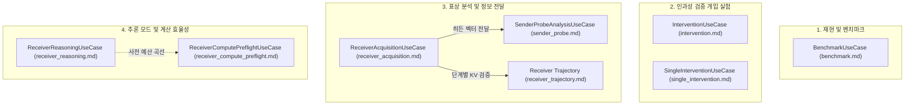

# Application Use Cases Index

이 문서는 LatentMAS Reprop 프로젝트의 애플리케이션 계층(`src/latentmas_reprop/application/`)에 정의된 **7대 핵심 유스케이스(Use Cases)**와 각 유스케이스별 상세 기술 명세 문서의 색인입니다.

모든 유스케이스는 **헥사고날 아키텍처(Hexagonal Architecture)**의 포트(Ports)와 도메인 모델/서비스를 조합하여 구체적인 연구 및 실험 워크플로를 오케스트레이션합니다.

---

## 📌 유스케이스 1:1 대응 맵핑 테이블

| 유스케이스 문서 | 대응 Application 클래스 | 실행 명령 (`just`) | 연구 목적 및 주요 기능 요약 |
| :--- | :--- | :--- | :--- |
| [**1. Benchmark**](benchmark.md) | `BenchmarkUseCase` | `just run -c <preset>` `just lmas reprop` | Single Baseline, TextMAS, LatentMAS 멀티에이전트 협업 벤치마크 및 원본 논문 재현 |
| [**2. Intervention**](intervention.md) | `InterventionUseCase` | `just run-intervention` | 잠재 통신 인과성 개입 실험 (`own`, `cross`, `drop`, `zero`) 및 McNemar 통계 검정 |
| [**3. Single Intervention**](single_intervention.md) | `SingleInterventionUseCase` | `just run-single-intervention` | 공통 상위 잠재 상태($P_1 \to L$)에서 3조건(`ple`, `plce`, `plpe`) 분기 분석, 10스텝 자동 체크포인트 및 증분 재개 |
| [**4. Receiver Acquisition**](receiver_acquisition.md) | `ReceiverAcquisitionUseCase` | `just run-acquisition` `just analyze-receiver` | 비밀 숫자(0~9) 운반 잠재 상태로부터 수신자의 비텍스트 캐리어 복원력 검증 및 상태 수집 |
| [**5. Sender Probe**](sender_probe.md) | `SenderProbeAnalysisUseCase` | `just analyze-sender-probe` | 수집된 송신자 히든 벡터에 대한 레이어/스텝별 로지스틱 회귀 및 Max-statistic 순열 검정 (GPU/CPU) |
| [**6. Receiver Reasoning**](receiver_reasoning.md) | `ReceiverReasoningUseCase` | `just run-receiver-reasoning` `just analyze-handoff` | 공유 상위 KV 캐시 기반 수신자 Answer-Only vs Free Reasoning 모드 비교 (3×2 쌍체 탐색) |
| [**7. Receiver Compute Preflight**](receiver_compute_preflight.md) | `ReceiverComputePreflightUseCase` | `just run-receiver-compute-preflight` `just analyze-receiver-compute-preflight` | 상위 잠재 스텝 $U$, 조건 $M$, 수신자 토큰 예산 $R$에 따른 계산 비용 곡선 사전 검증 및 토큰 접두사 무결성 검증 |

---

## 🔬 유스케이스 분류 체계

### 1. 재현 및 벤치마크 (Reproduction & Benchmarking)
- [**`benchmark.md`**](benchmark.md): Baseline(단일 에이전트), TextMAS(텍스트 기반 협업), LatentMAS(잠재 표현 기반 협업)의 GSM8K/MATH 등 벤치마크 평가를 총괄합니다.

### 2. 인과성 검증 개입 실험 (Causal Intervention Analysis)
- [**`intervention.md`**](intervention.md): 전달되는 KV 캐시를 치환/제거/영벡터화하여 잠재 통신의 인과적 기여를 증명합니다.
- [**`single_intervention.md`**](single_intervention.md): 동일한 상위 잠재 상태에서 직접 디코딩(`ple`), 제어 신호 주입(`plce`), 역할 프롬프트 주입(`plpe`)의 분기 관찰 및 10스텝 단위 증분 체크포인트를 제공합니다.

### 3. 표상 분석 및 정보 전달 (Carrier Transfer & Probing)
- [**`receiver_acquisition.md`**](receiver_acquisition.md): 텍스트 생성 없이 잠재 상태만으로 비밀 숫자가 수신자에게 전송되는지 측정합니다.
- [**`sender_probe.md`**](sender_probe.md): 송신자 내부 레이어/스텝에 비밀 정보가 선형 분리 가능한 형태로 인코딩되었는지 오프라인 선형 프로브로 분석합니다.
- [**`receiver_trajectory.md`**](receiver_trajectory.md): 1~20스텝 latent-only KV 수신 궤적 및 60개 셀에 대한 통신 산포도 오프라인 분석 명세입니다.

### 4. 추론 모드 및 계산 효율성 (Reasoning Modes & Compute Budgeting)
- [**`receiver_reasoning.md`**](receiver_reasoning.md): 상위 캐시를 전달받은 수신자가 즉각 답을 도출하는 모드와 자유 추론 트레이스를 작성하는 모드의 성능을 비교합니다.
- [**`receiver_compute_preflight.md`**](receiver_compute_preflight.md): 수신자의 유한 토큰 예산 $R$과 상위 잠재 스텝 $U$의 상관관계를 측정하고 토큰 접두사 무결성을 보장합니다.

---

## 🏛️ 아키텍처 및 공통 저장 원칙

모든 유스케이스는 다음 공통 인프라 규약을 따릅니다:

1. **`PathResolver` 기반 중앙 경로 관리**: 모든 영구 파일은 `storage/experiments/<task>/<model>/<method>/<prompt>/<params>/`의 결정론적 5단계 경로에 기록됩니다.
2. **원자적 완료 판정 (`FileStorage`)**: 조건별 디렉터리 내 필수 파일(`result.json`, `kv.pt`, `hidden.pt` 등)의 존재 여부로 완료 여부를 판정하며, 중단 시 미완료된 부분부터 안전하게 재개(Resumption)됩니다.
3. **MLflow 트래킹 연동 (`MLflowTracker`)**: 모든 실행은 메트릭, 파라미터, 태스크 트레이스 스팬을 SQLite 백엔드에 투명하게 기록합니다.
