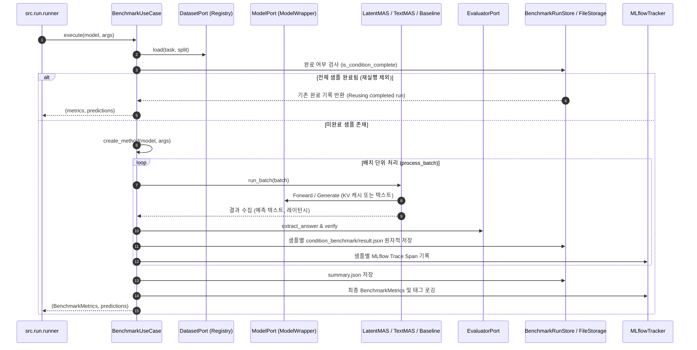

# Benchmark Use Case

`BenchmarkUseCase`는 LatentMAS 원본 논문(ICML 2026 Spotlight)의 핵심 실험을 재현하고, 표준 수학/추론 벤치마크 데이터셋에서 **단일 에이전트(Baseline)**, **텍스트 기반 멀티에이전트(TextMAS)**, **잠재 상태 기반 멀티에이전트(LatentMAS)**의 문제 해결 성능 및 실행 비용을 공정하게 평가·비교하는 핵심 유스케이스입니다.

---

## 1. 개요 및 연구 목적

* **연구 목적**:
  - LLM 에이전트 간 협업 시 텍스트 토큰을 주고받는 전통적인 방식(TextMAS)과 Key-Value(KV) 캐시 형태의 연속 잠재 표상을 전달하는 방식(LatentMAS)의 정답률 및 계산 효율성을 정량적으로 비교합니다.
  - 다양한 모델 크기(Qwen3 0.6B, 4B, 8B, 14B)와 벤치마크(GSM8K, MATH, HumanEval, ARC 등)에서 일관된 평가 환경을 제공합니다.
* **지원 방법론**:
  1. `baseline`: 단일 LLM이 Chain-of-Thought(CoT) 방식으로 문제를 단독 해결.
  2. `text_mas`: 순차적(Sequential) 또는 계층적 토폴로지에서 에이전트(Planner, Solver, Judger 등)들이 자연어 텍스트 트레이스를 교환하며 해결.
  3. `latent_mas`: 상위 에이전트들이 $T$ 스텝 동안 사고한 내부 연속 잠재 표현(Hidden States / Past KV Cache)을 수신 에이전트(Judger)에게 전달하여 최종 정답을 디코딩.

---

## 2. 대응 클래스 및 시스템 위치

* **애플리케이션 클래스**: [`BenchmarkUseCase`](file:///home/user3/projects/latentmas-reprop/src/latentmas_reprop/application/benchmark_use_case.py)
* **도메인 서비스**:
  - [`BaselineMethod`](file:///home/user3/projects/latentmas-reprop/src/latentmas_reprop/domain/services/baseline.py)
  - [`TextMASMethod`](file:///home/user3/projects/latentmas-reprop/src/latentmas_reprop/domain/services/text_mas.py)
  - [`LatentMASMethod`](file:///home/user3/projects/latentmas-reprop/src/latentmas_reprop/domain/services/latent_mas.py)
* **실행 모듈 진입점**:
  - `src/run/main.py` -> `src/run/runner.py` -> `BenchmarkUseCase.execute()`
* **실행 레시피**: `just run`, `just lmas reprop`

---

## 3. 실행 파이프라인 및 흐름



### 상세 단계:
1. **설정 확인 및 디렉터리 결정**:
   - `build_experiment_relpath`를 통해 고유 실험 경로 생성.
   - `BenchmarkRunStore`를 초기화하여 기존에 실행 완료된 샘플이 있는지 검사.
2. **증분 실행 (Resume 지원)**:
   - 각 샘플 디렉터리(`sample_XXXX/condition_benchmark/result.json`)의 존재 여부를 파악하여, 아직 처리되지 않은 샘플만 추려서 처리 큐에 삽입.
   - `--overwrite`가 주어지지 않은 한 이미 완료된 연산은 건너뜁니다.
3. **추론 및 평가**:
   - 지정된 배치 크기(`--generate_bs`) 단위로 모델 순전파 또는 생성 수행.
   - 데이터셋별 전용 Evaluator(GSM8K, MATH 등)가 예측 텍스트에서 최종 답안을 추출(`extract_answer`)하고 정답과 비교 검증.
4. **원자적 저장 및 로깅**:
   - 샘플별 결과 및 지연 시간(`latency_sec`)을 기록하고 임시 파일을 거쳐 원자적으로 이동(Atomic Write).
   - 모든 배치가 끝나면 전체 정확도, 총 소요 시간, 토큰 통계를 포함한 `summary.json`을 저장하고 MLflow 런을 마감(`FINISHED`).

---

## 4. 실행 방법 및 명령어 예시

### 4.1 기본 YAML 프리셋 실행
```bash
# Qwen3-8B 기반 LatentMAS GSM8K 벤치마크
just run -c lmas/reprop/lm_q38_gsm8k

# Single Baseline 실행
just run -c lmas/reprop/bs_q38_gsm8k

# TextMAS 실행
just run -c lmas/reprop/tm_q38_gsm8k
```

### 4.2 옵션 오버라이드 실행
```bash
# 10개 샘플만 빠르게 테스트, 배치 크기 2
just run -c lmas/reprop/lm_q38_gsm8k --max_samples 10 --generate_bs 2

# 기존 완료 결과를 무시하고 강제 재실행
just run -c lmas/reprop/lm_q38_gsm8k --overwrite
```

### 4.3 전체 모델 스케일 순차 실행
`justfile`의 `lmas reprop` 레시피는 0.6B -> 4B -> 8B -> 14B 순서로 3개 방법론(Baseline, TextMAS, LatentMAS)을 자동 순차 실행합니다:
```bash
just lmas reprop
```

---

## 5. 주요 설정 파라미터 (Configuration)

| 파라미터 키 | 타입 | 기본값 예시 | 설명 |
| :--- | :--- | :--- | :--- |
| `method` | `str` | `latent_mas` | 실행 방법론 (`baseline`, `text_mas`, `latent_mas`) |
| `model_name` | `str` | `Qwen/Qwen3-8B` | HuggingFace 모델 식별자 또는 로컬 가중치 경로 |
| `task` | `str` | `gsm8k` | 태스크 데이터셋 이름 (`gsm8k`, `aime2024`, `math`, `arc_c`, `medqa` 등) |
| `split` | `str` | `test` | 데이터셋 분할 (`test`, `train`) |
| `latent_steps` | `int` | `20` | LatentMAS에서 상위 에이전트가 생성하는 연속 잠재 스텝 수 ($T$) |
| `max_new_tokens` | `int` | `2048` | 최종 Judger 또는 Baseline이 생성할 수 있는 최대 신규 토큰 수 |
| `generate_bs` | `int` | `1` | 배치 생성 크기 |
| `temperature` | `float` | `0.6` | 텍스트 생성 샘플링 온도 |
| `top_p` | `float` | `0.95` | Nucleus 샘플링 확률 |
| `use_vllm` | `bool` | `false` | vLLM 가속 백엔드 사용 여부 (LatentMAS transformers 기본 권장) |
| `tracking_experiment_name` | `str` | `latentmas_benchmark` | MLflow 실험 이름 |

---

## 6. 저장 구조 및 산출물

`BenchmarkUseCase`는 중앙 저장소(`storage/experiments/`)의 5단계 경로 계층을 따릅니다:

```text
storage/experiments/<task>/<model>/<method>/<prompt>/<params>/
├── summary.json                     # 실행 완료 상태, 최종 정확도 및 지연 통계
└── sample_0000/
    └── condition_benchmark/
        └── result.json              # 개별 샘플의 입력, 예측 텍스트, 정답 여부, latency
```

* `summary.json` 예시:
  ```json
  {
    "status": "complete",
    "metrics": {
      "accuracy": 0.85,
      "correct": 85,
      "total": 100,
      "total_time_sec": 412.5,
      "avg_latency_sec": 4.12
    },
    "config": {
      "method": "latent_mas",
      "latent_steps": 20,
      "task": "gsm8k"
    }
  }
  ```
