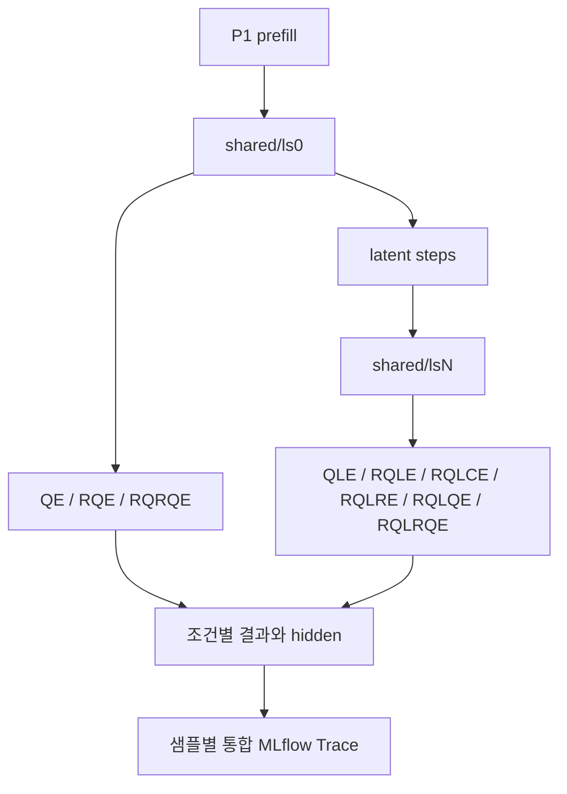

# LMAS Intervention Continuation Analysis

R은 역할 지시, Q는 문제, L은 잠재 계산, C는 제어 신호, E는 명시적 생성입니다. 초기 역할 R₁과 후속 역할 R₂는 서로 다를 수 있으며 기본값은 각각 Planner와 Judger입니다. 실제 P1과 개입 프롬프트 및 토큰 ID가 기록됩니다.

| 조건 | 순서 | 저장 식별자 |
|---|---|---|
| QE | Q → E | pe (question_only P1) |
| RQE | R₁(Q) → E | pe |
| QLE | Q → L → E | ple (question_only P1) |
| RQLE | R₁(Q) → L → E | ple |
| RQLCE | R₁(Q) → L → C → E | plce |
| RQLRE | R₁(Q) → L → R₂ → E | rqlre |
| RQLQE | R₁(Q) → L → Q → E | rqlqe |
| RQLRQE | R₁(Q) → L → R₂(Q) → E | plpe |
| RQRQE | R₁(Q) → R₂(Q) → E | rqrqe |

기존 `pe`, `ple`, `plce`, `plpe` 별칭과 결과 경로는 유지됩니다. 역할이나 문제 구성으로 분류할 수 없는 커스텀 프롬프트는 기존 명칭으로 표시합니다.

---

## 1. 개요 및 연구 목적

동일 P1의 저장된 공통 상태에서 분기해 개입과 명시적 생성의 영향을 비교합니다. `QE`, `RQE`, `RQRQE`는 ls0에서 분기하며 잠재 forward를 수행하지 않습니다. 다른 조건은 목표 lsN을 재사용합니다. 기본 Planner 조건은 RQE, RQLE, RQLCE, RQLRE, RQLQE, RQLRQE, RQRQE이며 question_only 기본 조건은 QE, QLE입니다.

---

## 2. 대응 클래스 및 시스템 위치

* **애플리케이션 클래스**: [`InterventionContinuationUseCase`](file:///home/user3/projects/latentmas-reprop/src/latentmas_reprop/application/intervention_continuation_use_case.py)
* **세부 모듈**:
  - `latentmas_reprop.application.intervention_continuation.runner`: 공통 잠재 연산 및 조건별 분기 디코더 오케스트레이션
  - `latentmas_reprop.application.intervention_continuation.checkpoint`: 10스텝 단위 중간 체크포인트 저장 및 증분 재개 탐색
  - `latentmas_reprop.application.intervention_continuation.artifacts`: 메트릭 집계 및 MLflow/디스크 원자적 저장
* **실행 모듈 진입점**:
  - `src/run/main.py` -> `src/run/runner.py` (`--intervention_continuation` 플래그)
* **실행 레시피**: `just run-intervention-continuation`

---

## 3. 핵심 유스케이스 흐름 (UC-01 ~ UC-04)



### UC-01. 공통 잠재 계산 (`shared`)
* 상위 Planner 프롬프트($P_1$)로부터 $T$개의 잠재 스텝($L_1 \to \dots \to L_T$)을 수행합니다.
* 샘플당 단 1회만 계산하며, 분기 직전 전체 KV 캐시 스냅샷(`kv.pt`)과 프롬프트 및 각 잠재 스텝의 최종 히든 벡터(`hidden.pt`)를 저장합니다.

### UC-02. 조건별 독립 분기
* PE 및 RQRQE는 `ls0`에서, 잠재 조건은 요청한 `lsN`에서 시작합니다. 각 분기는 KV를 복제합니다.
* 분기 이후 생성되는 토큰과 KV 상태는 서로 완전히 독립적으로 갱신됩니다.
* 개입 토큰 및 생성 구간의 위치별 최종 히든 벡터를 1:1 대응하여 기록합니다.

### UC-03. 완료 판정 및 재실행 정책
* 조건별 `result.json`과 필수 파일(`hidden.pt`)의 존재 여부가 완료 판정의 유일한 진실 공급원(Source of Truth)입니다.
* 중단 후 재실행 시 완료된 조건은 건너뛰고 미완료된 조건만 계산합니다.
* `--overwrite`는 지원하지 않습니다. 다른 결과가 필요하면 별도 저장 루트를 사용합니다.

### UC-04. 사후 분석
* 원본 추론을 재실행하지 않고, `ResearchDataReader`를 통해 저장된 `hidden.pt`와 `kv.pt`를 직접 로드하여 로짓/엔트로피 복원, 상태 변화 분석, 추가 개입 실험을 수행합니다.

---

## 4. 중간 체크포인트 자동 저장 및 증분 재개 (Incremental Resumption)

### 1) 10스텝 단위 중간 체크포인트
잠재 스텝은 인과적(Causal) 누적 연산이므로, $T=40$을 수행하는 도중의 $T=10, 20, 30$ 상태는 해당 스텝 수 단독 실험의 상태와 수학적으로 100% 동일합니다.
* 기본 설정(`latent_step_checkpoint_interval: 10`)에 따라 10스텝마다 중간 `shared` 스냅샷(`ls10`, `ls20`, `ls30` 등)이 자동 보관됩니다.

### 2) 증분 재개 (Incremental Resumption)
* 예를 들어 기존에 `ls20` 실험이 완료된 상태에서 `--latent_steps 40`을 실행할 경우:
  1. 기존 `ls20` 경로의 `shared/kv.pt` 및 `shared/hidden.pt`를 자동으로 감지합니다.
  2. 프롬프트 및 1~20스텝 연산을 완전히 건너뜁니다 (0초 소요).
  3. 21~40스텝(20회)만 추가 forward한 뒤, 히든 궤적을 병합하여 `ls40`에 저장하고 분기 디코딩을 수행합니다.
  4. 도중에 통과하는 30스텝 시점에는 `ls30` 체크포인트도 자동으로 저장됩니다.

---

## 5. 영구 저장 구조

`storage/experiments/intervention_continuation/<task>/<model>/<state-hash>/` 아래에
샘플별 `shared/ls0`과 `shared/lsN` 구간을 저장합니다. `ls0`은 전체 prompt KV이고,
각 `lsN`은 이전 저장 경계 이후의 KV 구간과 전체 hidden을 포함합니다.
조건 결과는 `samples/<sample>/results/lsN/<result-hash>/<condition>/`에,
조건별 요약과 reader 참조는 `runs/<run-hash>/`에 저장합니다. PE와 RQRQE의 N은 항상 0입니다.
상태와 결과 식별 및 구간 조립 계약은 [리팩터링 설계](../intervention_continuation_refactor.md)를 참조하세요.

디코딩 RNG는 결과 식별과 샘플 인덱스에서 고정하므로 조건 순서나 완료된 결과의
건너뛰기에 영향을 받지 않습니다. 요청한 `top_p`는 결과 식별에 포함되지만 현재
디코더의 샘플링에는 적용되지 않습니다.

---

## 6. 실행 설정 및 프리셋

* **기본 프리셋 파일**: [`configs/intervention_continuation/gsm8k_q38.yaml`](file:///home/user3/projects/latentmas-reprop/configs/intervention_continuation/gsm8k_q38.yaml)
* **$P_1$ 프롬프트 바리언트 정의 파일**: [`configs/prompts/intervention_p1.yaml`](file:///home/user3/projects/latentmas-reprop/configs/prompts/intervention_p1.yaml)
  - `planner` (기본값): 기존 LatentMAS Sequential Planner 프롬프트 (최종 답 없이 단계별 계획만 작성 지시)
  - `direct_solve`: Single-agent 스타일로 즉시 단계별 추론 및 `\boxed{}` 최종 정답 도출 지시
  - `question_only`: 역할이나 지시문 없이 `Question: {question}`만 제시
  - `latent_think`: 내부 잠재 상태에서 단계별로 깊이 생각한 뒤 답을 내도록 지시
  - `math_agent`: Hierarchical LatentMAS 스타일의 Math Agent 프롬프트

```yaml
method: latent_mas
model_name: Qwen/Qwen3-8B
task: gsm8k
prompt: sequential
max_samples: -1  # 전체 데이터셋 (1,319개)
latent_steps: 20
max_new_tokens: 2048
temperature: 0.6
top_p: 0.95
seed: 42
intervention_continuation: true
p1_variant: "planner"
# intervention_conditions를 생략하면 P1별 기본 조건을 사용
control_signal: "\nSolution:"
receiver_role: "judger"
latent_step_checkpoint_interval: 10
```

* **MLflow 실험 이름**: `latentmas/intervention/continuation` (`use_cases.py`에서 일원화 관리)

---

## 7. 실행 명령어 요약

### 1) 기본 프리셋 실행
```bash
# 기본 설정으로 실행 (지정 디바이스 활성화 권장)
CUDA_VISIBLE_DEVICES=3 just run-intervention-continuation -c intervention_continuation/gsm8k_q38
```

### 2) 파라미터 오버라이드
```bash
# 40스텝으로 실행 (기존 20스텝 체크포인트에서 21~40스텝만 증분 실행)
CUDA_VISIBLE_DEVICES=3 just run-intervention-continuation -c intervention_continuation/gsm8k_q38 --latent_steps 40

# 샘플 수 제한 실행 (스모크 테스트)
CUDA_VISIBLE_DEVICES=3 just run-intervention-continuation -c intervention_continuation/gsm8k_q38 --max_samples 10

# 제어 신호 또는 수신자 역할 변경
CUDA_VISIBLE_DEVICES=3 just run-intervention-continuation -c intervention_continuation/gsm8k_q38 \
  --control_signal "\nAnswer:" \
  --receiver_role critic

# 첫 번째 프롬프트(P_1) 바리언트 변경 (경로 및 MLflow Run 자동 격리)
CUDA_VISIBLE_DEVICES=3 just run-intervention-continuation -c intervention_continuation/gsm8k_q38 \
  --p1_variant direct_solve

# 첫 번째 프롬프트(P_1) 커스텀 템플릿 직접 지정
CUDA_VISIBLE_DEVICES=3 just run-intervention-continuation -c intervention_continuation/gsm8k_q38 \
  --p1_prompt "Solve this math problem carefully:\n{question}"
```

### 3) 드라이런 (설정 검증)
```bash
just run-intervention-continuation -c intervention_continuation/gsm8k_q38 --dry-run
```

---

## 8. 진행도 표시 모니터링 (`tqdm`)

실행 중 터미널에 3단계 계층의 실시간 진행도가 출력됩니다:
1. **전체 샘플 진행도**: `Intervention Continuation: 45%|████... [01:23<02:15, 12.3s/sample]`
2. **공통 잠재 스텝 진행도**: `Common latent (21..40): 75%|███████▌...`
3. **조건별 토큰 생성 진행도**: `Decoding · PLE: 15%|█▌...`, `Decoding · PLCE: ...`, `Decoding · PLPE: ...`

*(진행도 출력을 끄려면 `--no_progress` 옵션을 추가합니다.)*

---

## 9. MLflow 샘플별 통합 Trace

`latentmas/intervention/continuation`의 Run은 P1 상태, 목표 latent step과 실행·디코딩 설정으로 구분합니다. 조건 목록과 샘플 수는 Run 식별에 영향을 주지 않습니다. 동일 Run의 각 샘플 Trace에는 `common_latent`와 완료된 조건별 `decode_<조건>` 스팬이 포함됩니다. 스팬 입력에는 실제 분기 step, 역할, 개입 원문과 토큰 ID가 기록됩니다.

재실행은 저장된 결과를 읽어 변경이 없으면 Trace를 유지합니다. 조건이 추가되거나 Trace가 누락되면 저장된 결과로 새 Trace를 만들고 MLflow에서 필요한 스팬을 검증합니다. 성공 후에만 같은 Run과 샘플의 이전 Trace를 ID로 삭제합니다. 기록 또는 삭제 실패는 오류로 전달하며 로컬 계산 결과는 유지합니다.

## Legacy checkpoint migration

`just migrate-intervention-continuation` inspects legacy cumulative checkpoints without writing; pass `--apply` to publish validated samples. Existing source files and MLflow runs are not changed.

The tool groups candidates using recorded prompt tokens where available, compares every overlapping KV and hidden prefix exactly, and reports each sample as mergeable, conflicting, or failed. It reconstructs ls0 and segments at ten-step and original partial boundaries, then checks the assembled KV against every original checkpoint. Completed condition results and trace IDs are copied to the new result paths. Existing run IDs resolve to new run records without changing MLflow.

Historical model and tokenizer revisions, execution environment and RNG validation are recorded as unknown when unavailable. Migrated trajectories have a separate legacy identity and are readable by the new reader, but are not automatically selected for new model inference. No duplicated quarantine copy is made for failed or conflicting samples; their original files are retained. Run configuration, summaries, samples and other result files are retained in the new run records.
