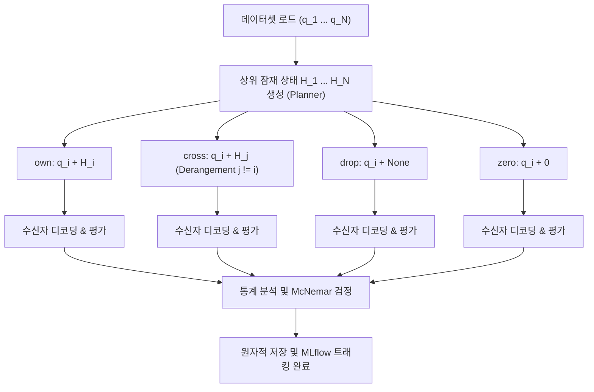

# Latent Communication Intervention Use Case

`InterventionKvUseCase`는 에이전트 간 잠재 통신(Latent Communication)에서 전달되는 연속 표상(KV 캐시)이 수신자의 최종 추론 성공에 **실질적인 인과적 기여(Causal Contribution)**를 하는지 엄밀하게 검증하기 위한 인과적 개입 분석 유스케이스입니다.

---

## 1. 개요 및 연구 목적

* **연구 목적**:
  - 수신 에이전트가 높은 정답률을 보이는 원인이 "전달받은 잠재 상태에 담긴 유효한 정보" 때문인지, 아니면 단순히 "자체적인 사전 지식이나 프롬프트" 때문인지를 규명합니다.
  - 상위 잠재 상태를 왜곡하거나 차단하는 4가지 상호 배타적 개입(Intervention) 조건을 적용하고, 수신자의 행동 변화 및 통계적 유의성(McNemar's Test)을 측정합니다.

* **4대 인과적 개입 조건**:
  | 조건명 | 계산 수식 | 개입 메커니즘 | 연구적 의미 |
  | :--- | :--- | :--- | :--- |
  | **`own`** | $q_i + H_i$ | 정상적인 본인 샘플의 잠재 캐시 주입 | **기준선(Control)**: 온전한 잠재 협업 상태의 성공률 |
  | **`cross`** | $q_i + H_j \; (j \neq i)$ | 서로 다른 문제($j$)에서 추출된 잠재 캐시를 주입 | **내용 불일치 개입**: 문맥과 무관한 잠재 정보가 주입될 때의 교란 효과 검증 |
  | **`drop`** | $q_i + \varnothing$ | 잠재 캐시 전달을 완전 차단 (No Cache) | **통신 부재 개입**: 잠재 통신 자체가 완전히 제거되었을 때의 성능 하락 측정 |
  | **`zero`** | $q_i + \mathbf{0}$ | 캐시의 텐서 형상과 위치는 유지하되 모든 값을 0으로 마스킹 | **구조 보존 개입**: 토큰 위치 메타데이터 대비 실제 표상 벡터 값의 순수 기여도 분리 |

---

## 2. 대응 클래스 및 시스템 위치

* **애플리케이션 클래스**: [`InterventionKvUseCase`](file:///home/user3/projects/latentmas-reprop/src/latentmas_reprop/application/intervention_kv_use_case.py)
* **주요 헬퍼 및 통계 모듈**:
  - `latentmas_reprop.application.intervention_kv.algo`: Derangement 기반 `cross` 인덱스 생성
  - `latentmas_reprop.application.intervention_kv.context_builder`: 4가지 개입 조건별 KV 캐시 구축
  - `latentmas_reprop.application.intervention_kv.stats`: 조건별 정확도 및 McNemar 통계 검정 계산
  - `latentmas_reprop.application.intervention_kv.runner`: 조건별 디코딩 실행
* **실행 모듈 진입점**:
  - `src/run/main.py` -> `src/run/runner.py` (`--intervention_kv` 플래그)
* **실행 레시피**: `just run-intervention-kv`
* **MLflow 실험 이름**: `latentmas/intervention/kv`

---

## 3. 실행 파이프라인 및 워크플로



### 상세 단계:
1. **상위 잠재 상태 구축 (`H_i`)**:
   - Planner 에이전트가 각 질문 $q_i$에 대해 $T$ 잠재 스텝 동안 생성한 Key-Value 텐서 스택을 추출합니다.
2. **`cross` 매칭 생성 (`generate_cross_indices`)**:
   - 자기 자신과 겹치지 않는 완전 순열(Derangement) 알고리즘을 적용하여, 모든 $i$에 대해 $j \ne i$인 $H_j$를 1:1 결정론적으로 매핑합니다.
3. **조건별 병렬/순차 디코딩**:
   - `build_intervention_contexts`가 수신자(Judger) 입력에 맞춰 KV 캐시를 조작합니다:
     - `own`: 복제된 원본 $H_i$ 연결.
     - `cross`: 매핑된 $H_j$ 연결.
     - `drop`: `past_key_values` 없이 순수 질문 $q_i$만 주입.
     - `zero`: $H_i$와 동일한 shape의 영텐서(zeros_like) 생성 주입.
4. **McNemar 유의성 검정**:
   - `own` vs `cross`, `own` vs `drop`, `own` vs `zero` 간의 2×2 분할표(Contingency Table)를 구성하여 McNemar 검정 통계량과 $p$-value를 계산합니다.
   - 잠재 통신이 유효하다면 $p < 0.05$ 수준에서 `own`의 정답률이 유의미하게 높아야 합니다.

---

## 4. 실행 방법 및 명령어 예시

```bash
# 기본 인터벤션 실험 실행 (YAML 프리셋 기반)
just run-intervention-kv -c intervention_kv/gsm8k_q38 --max_samples 100

# 세부 개입 조건 및 샘플 지정 실행
uv run python -m src.run --intervention_kv \
  --model_name Qwen/Qwen3-8B \
  --task gsm8k \
  --latent_steps 20 \
  --max_samples 50 \
  --intervention_conditions own,cross,drop,zero
```

---

## 5. 산출 메트릭 및 통계 분석

`InterventionKvUseCase`는 단순 정답률 외에 다음과 같은 엄밀한 비교 지표를 산출합니다:

1. **조건별 정확도**:
   - `acc_own`: 본인 잠재 상태 주입 시 정확도
   - `acc_cross`: 타인 잠재 상태 주입 시 정확도
   - `acc_drop`: 통신 차단 시 정확도
   - `acc_zero`: 영벡터 주입 시 정확도
2. **McNemar 통계 지표**:
   - `mcnemar_own_vs_cross_p`: $H_i$의 고유 정보 기여도 검정 p-값
   - `mcnemar_own_vs_drop_p`: 잠재 통신 자체의 존재 유의성 p-값
   - `mcnemar_own_vs_zero_p`: 텐서 값(Value)의 의미론적 기여도 p-값
3. **리소스 지표**:
   - `cache_footprint_mb`: 샘플당 KV 캐시 용량(MB)
   - `peak_gpu_ram_gb`: 피크 VRAM 사용량

---

## 6. 저장 구조 및 영구 보관

각 샘플은 조건별 디렉터리로 엄격히 격리 저장되어, 중간 중단 시 완료된 조건은 건너뛰고 미완료 조건만 계산합니다:

```text
storage/experiments/<task>/<model>/<method>/<prompt>/<params>_intervention_kv/
├── summary.json                     # 조건별 종합 정확도 및 McNemar p-value 요약
└── sample_0000/
    ├── condition_own/
    │   └── result.json              # own 조건 디코딩 텍스트 및 정답 여부
    ├── condition_cross/
    │   └── result.json              # cross 조건 디코딩 텍스트 및 정답 여부
    ├── condition_drop/
    │   └── result.json              # drop 조건 디코딩 텍스트 및 정답 여부
    └── condition_zero/
        └── result.json              # zero 조건 디코딩 텍스트 및 정답 여부
```
