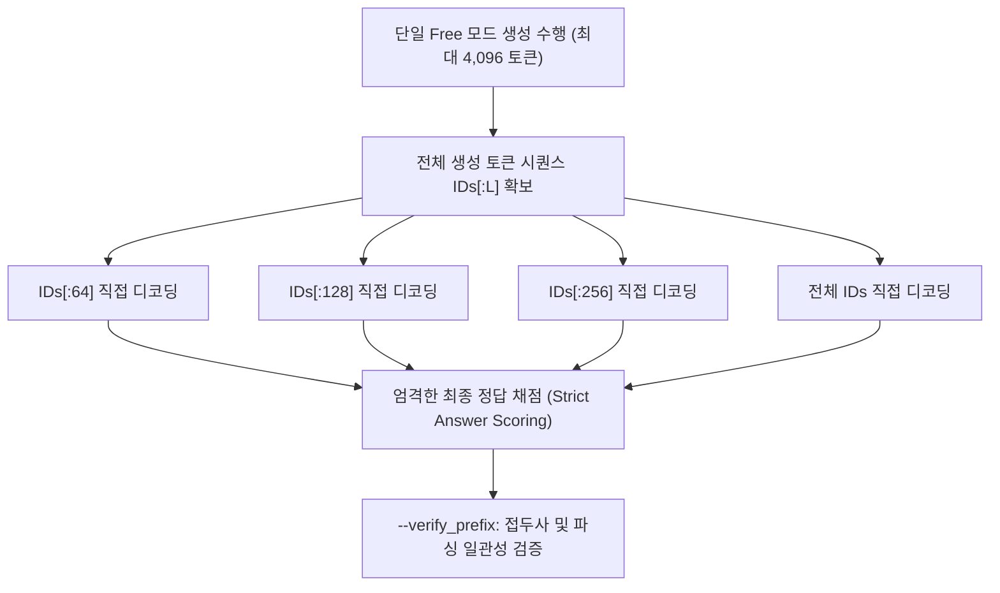

# Receiver Compute Preflight Use Case

`ReceiverComputePreflightUseCase`는 상위 잠재 스텝 $U$, 캐시 정합성 조건 $M$(`matched`, `mismatched`, `no_handoff`), 그리고 수신자의 유한 토큰 예산 $R$에 따른 **수신자 추론 정확도 및 계산 비용 곡선(Compute Budget Curves)**을 사전에 측정하고, 토큰 생성의 접두사 무결성(`--verify_prefix`)을 검증하는 유스케이스입니다.

---

## 1. 개요 및 연구 목적

* **연구 목적**:
  - 수신 에이전트가 문제를 풀 때 허용되는 신규 토큰 생성 예산($R$)을 단계적으로 제한(64, 128, 256, 512, 1024, `free`)했을 때, 정답률이 포화되는 지점(Saturation Point)을 관찰합니다.
  - 상위 잠재 캐시를 올바르게 연결한 조건(`matched`), 다른 문제의 캐시를 연결한 조건(`mismatched`), 캐시가 없는 조건(`no_handoff`) 간의 비용-성능 곡선을 측정합니다.
* **실험 차원**:
  - $U$ (Upstream Steps): 10, 20 등 (콤마 구분 문자열)
  - $M$ (Handoff Condition): `matched`, `mismatched`, `no_handoff`
  - $R$ (Receiver Budgets): 64, 128, 256, 512, 1024, `free` (기본 4096 상한, 재시도 최대 8192)

---

## 2. 대응 클래스 및 시스템 위치

* **애플리케이션 클래스**: [`ReceiverComputePreflightUseCase`](file:///home/user3/projects/latentmas-reprop/src/latentmas_reprop/application/receiver_compute_preflight_use_case.py)
* **세부 모듈 (`latentmas_reprop.application.receiver_compute_preflight`)**:
  - `collection.py`: 단일 궤적 기반 다중 $R$ 예산 파싱 및 접두사 검증
  - `tracing.py`: MLflow 실행 트레이스 및 신원 관리
  - `scoring.py`: 엄격한 최종 정답(`\boxed{}` 및 `Final answer:`) 추출기
* **실행 모듈 진입점**:
  - `src/run/main.py` -> `src/run/runner.py` (`--receiver_compute_preflight` 플래그)
  - `src/run/compute_preflight_analysis.py` (`just analyze-receiver-compute-preflight`)
* **실행 레시피**: `just run-receiver-compute-preflight`, `just analyze-receiver-compute-preflight`

---

## 3. 핵심 검증 메커니즘



### 1) 엄격한 최종 정답 채점 (Strict Final-Answer Scoring)
모든 예산 $R$에서의 채점은 명시적 최종 정답 형식을 엄격히 요구합니다:
- 완전한 `\boxed{...}` 수식 또는 명시적 `Final answer: ...` / `Final answer is ...` 형태만 인정.
- 문맥 중간에 등장하는 단순 숫자는 정답으로 인정되지 않음.
- 토큰 예산이 잘려서(Cutoff) 숫자가 중간에 끊기거나, 미완성된 답변 마커가 뒤에 남은 경우 `no_answer=true`, `correct=false` 처리.
- 텍스트 모델의 `<think>` 내부 내용은 완벽히 배제.

### 2) 토큰 접두사 무결성 검증 (`--verify_prefix`)
- 모델을 각 예산마다 반복 추론하여 비효율을 초래하지 않고, **단 한 번의 긴 Free 디코딩 궤적**을 수집한 뒤 `token_ids[:R]`을 직접 슬라이싱하여 평가합니다.
- `--verify_prefix` 옵션은 슬라이싱된 토큰 ID가 실제 모델이 해당 예산까지 생성했을 결과와 토큰 ID 수준에서 100% 동일한지를 2개 샘플에 대해 엄격히 검증합니다.

### 3) 계산량 프록시 정의
- 단순 하드웨어 종속적인 FLOPs 대신, **레이어/헤드별 인과적 어텐션 페어(Causal Attention Pairs)**와 **처리된 트랜스포머 토큰 위치 수**를 계산 복잡도의 진실 공급원으로 측정합니다.

---

## 4. 실행 방법 및 명령어 예시

### 4.1 실행 계획 검증 (드라이런)
```bash
just run-receiver-compute-preflight -c lmas/receiver_compute_preflight/gsm8k --dry-run
```

### 4.2 스모크 테스트 (2샘플 소형 모델 접두사 검증)
```bash
just run-receiver-compute-preflight -c lmas/receiver_compute_preflight/gsm8k \
  --model_name Qwen/Qwen3-0.6B --max_samples 2 --upstream_steps 1,2 \
  --receiver_budgets 8,16,free --max_new_tokens 32 --free_max_new_tokens 64 \
  --verify_prefix
```

### 4.3 전체 실험 및 오프라인 분석
```bash
# 전체 프리셋 실행
just run-receiver-compute-preflight -c lmas/receiver_compute_preflight/gsm8k

# 오프라인 집계 분석 (추론 없이 결과 리포트 및 플롯 생성)
just analyze-receiver-compute-preflight --model all
just analyze-receiver-compute-preflight --model 4B
```

---

## 5. 저장 구조 및 산출물

```text
storage/experiments/gsm8k/<model>/latent_mas/.../
├── collection_summary.json          # 수집 완료 상태 및 설정
├── metrics.json                     # 조건별/예산별 최종 정답률 곡선
├── summary.md                       # 수신자 계산 비용 마크다운 리포트
└── sample_results.jsonl             # 개별 시도별 생성 ID, 자른 시점 텍스트, 채점 결과
```
