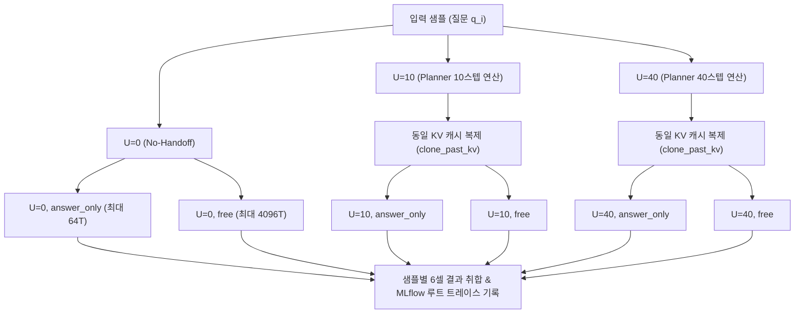

# Receiver Reasoning Exploration Use Case

`ReceiverReasoningUseCase`는 상위 잠재 연산의 Key-Value(KV) 캐시를 전달받은 수신 에이전트(Judger)가 직접 답만 도출하는 모드(**`answer_only`**)와 자체적인 자유 사고 트레이스를 작성하는 모드(**`free`**) 간의 추론 거동 및 상호작용을 체계적으로 탐색·비교하는 유스케이스입니다.

---

## 1. 개요 및 연구 목적

* **연구 목적**:
  - 상위 에이전트가 더 많은 잠재 스텝($U=10, 40$ 등)을 계산하여 넘겨주었을 때, 수신자가 직접 즉시 단답을 출력하는 능력(`answer_only`)과 장문 추론을 거쳐 출력하는 능력(`free`)이 각각 어떻게 변화하는지 관찰합니다.
  - **대체 신호(Substitution Signal)**: 상위의 잠재 연산 증가가 수신자의 명시적 텍스트 추론 토큰 생성을 실제로 대체할 수 있는지 탐색합니다.
* **실험 구성 ($3 \times 2$ Paired Matrix)**:
  - **상위 계산 스텝 축 ($U$)**:
    - $U=0$: 상위 연산 및 캐시 전달이 전혀 없는 기준선(No-Handoff Baseline)
    - $U=10$ (Low Compute): 적은 수의 잠재 스텝
    - $U=40$ (High Compute): 많은 수의 잠재 스텝
  - **수신자 디코딩 모드 축**:
    - `answer_only`: Thinking을 비활성화하고, 즉각적인 답안 출력 유도 (`\boxed{` 프리필, 최대 64 토큰)
    - `free`: 원본 Judger 프롬프트를 유지하며 장문 자유 추론 수행 (최대 4096 토큰 예산)

---

## 2. 대응 클래스 및 시스템 위치

* **애플리케이션 클래스**: [`ReceiverReasoningUseCase`](file:///home/user3/projects/latentmas-reprop/src/latentmas_reprop/application/receiver_reasoning_use_case.py)
* **세부 모듈 (`latentmas_reprop.application.receiver_reasoning`)**:
  - `runner.py`: 상위 1회 연산 및 동일 KV 복제를 통한 6개 분기 셀 순전파
  - `metrics.py`: 셀별 정확도, 생성 토큰 통계, 대체 신호 계산
  - `runtime.py`: 레이턴시 및 VRAM 측정
* **실행 모듈 진입점**:
  - `src/run/main.py` -> `src/run/runner.py` (`--receiver_reasoning` 플래그)
  - `src/run/handoff_analysis.py` (`just analyze-handoff`)
* **실행 레시피**: `just run-receiver-reasoning`, `just analyze-handoff`

---

## 3. 실행 파이프라인 및 아키텍처



### 상세 단계:
1. **상위 1회 연산 및 공유 (Upstream Single-Pass)**:
   - 각 샘플 및 상위 계산 수준($U$)마다 상위 추론을 정확히 1회만 실행합니다.
   - 두 수신자 모드(`answer_only`, `free`)는 동일한 상위 KV 캐시의 독립적인 딥카피(Deep Copy)를 전달받아 시작합니다.
2. **캐시 핸드오프 모드**:
   - `full` (기본값): 상위 프롬프트와 잠재 스텝 전체 위치의 KV 캐시를 전달.
   - `tail` (`--handoff_positions K`): 상위 연산 전체를 수행한 뒤, 마지막 $K$개 위치의 KV 캐시만 잘라내어(Slice) 전달 (전송 폭 고정 비교 시 활용).
3. **결정론적 디코딩 보장**:
   - 탐욕적 디코딩(`temperature=0.0`, `top_p=1.0`)을 강제 적용합니다.
4. **완전한 궤적 트레이싱**:
   - 샘플 1개당 1개의 MLflow 루트 트레이스가 생성되며, 그 안에 상위 연산 스팬과 6개 수신자 분기 스팬(총 120개 디코딩/20샘플)이 프롬프트, 출력, 토큰 수, 레이턴시, VRAM과 함께 기록됩니다.

---

## 4. 실행 방법 및 명령어 예시

### 4.1 기본 실행 및 프리셋
```bash
# 기본 프리셋 실행 (Qwen3-4B 기준)
just run-receiver-reasoning -c lmas/receiver_reasoning/gsm8k

# 모델별 20샘플 프리셋 실행
just run-receiver-reasoning -c lmas/receiver_reasoning/lm_q34_gsm8k
just run-receiver-reasoning -c lmas/receiver_reasoning/lm_q30.6_gsm8k

# 추론 없이 설정 전개만 확인 (드라이런)
just run-receiver-reasoning -c lmas/receiver_reasoning/lm_q34_gsm8k --dry-run
```

### 4.2 오프라인 핸드오프 파일럿 분석 (MLflow 기반 통계 재분석)
추론을 재수행하지 않고 MLflow에 저장된 아티팩트로부터 5,000회 부트스트랩 신뢰구간 및 paired 분석을 수행합니다:
```bash
just analyze-handoff --version-tag pilot-v1
```

---

## 5. 주요 설정 파라미터

| 파라미터 키 | 타입 | 기본값 | 설명 |
| :--- | :--- | :--- | :--- |
| `upstream_steps` | `str` | `"10,40"` | 비교할 상위 잠재 스텝 수 (콤마 구분 문자열, 0은 자동 포함) |
| `handoff_positions` | `int` | `None` | Tail handoff 시 전달할 마지막 토큰 수 (지정하지 않으면 `full`) |
| `max_samples` | `int` | `20` | 쌍체 비교를 수행할 샘플 수 |
| `free_max_new_tokens` | `int` | `4096` | Free 모드의 최대 생성 토큰 예산 |
| `answer_only_max_tokens` | `int` | `64` | Answer-only 모드의 토큰 상한 |
| `version_tag` | `str` | `pilot-v1` | MLflow 태깅 및 오프라인 분석 식별자 |

---

## 6. 저장 구조 및 산출물

```text
.cache/evaluation/runs/receiver_reasoning_<exp_id>/
├── summary.json                     # 셀별 정확도, 토큰 통계, 대체 신호
├── sample_results.jsonl             # 6개 셀 관측치 (20샘플 기준 120개 레코드)
└── resolved_config.yaml             # 실행 시점 설정 및 Git 해시
```

* `summary.json` 핵심 메트릭:
  - `accuracy[U, mode]`: 각 셀의 정답률
  - `D(S) = Acc(S, free) - Acc(S, answer_only)`: 잠재 스텝 $S$에서의 모드 간 정확도 격차
  - `substitution_signal = D(low) - D(high)`: 상위 연산 증가에 따른 단답 모드 대체 효과 신호
