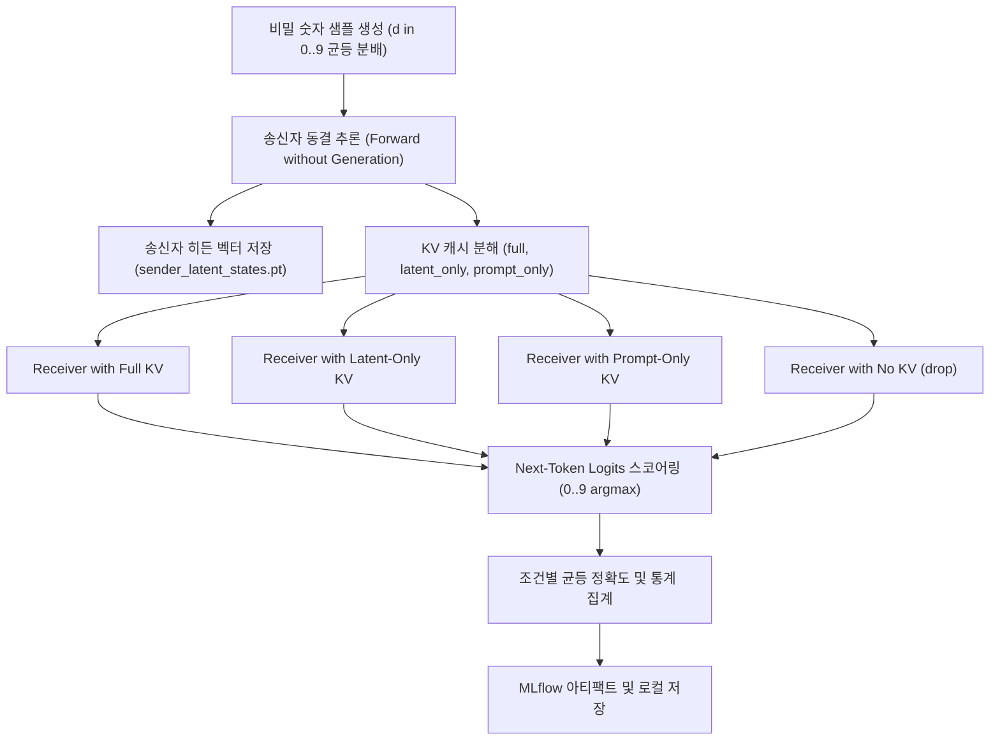

# Representation Acquisition Use Case

`RepresentationAcquisitionUseCase`는 멀티에이전트 통신에서 텍스트 생성(Text Generation)을 일체 거치지 않고, 오직 상위 에이전트의 **연속 잠재 상태(Past Key-Value Cache)**만을 통해 비밀 숫자(Secret Digit: $0 \sim 9$)가 수신자에게 온전히 전달 및 획득(Acquisition)되는지를 검증하는 핵심 표상 전달 유스케이스입니다.

---

## 1. 개요 및 연구 목적

* **연구 목적**:
  - LLM 에이전트가 단어 토큰을 출력하지 않고 내부 활성화(Activation) 및 KV 캐시만 넘겨줄 때, 수신자 모델이 그 잠재 벡터로부터 원래의 정보를 얼마나 정확하게 추출해낼 수 있는지 측정합니다.
  - 전송되는 컨텍스트를 분해(Decomposition)하여, 정보가 **"프롬프트 토큰의 KV"**에 남아있는지, **"새롭게 생성된 잠재 스텝 토큰의 KV"**에 압축되어 담겨있는지, 아니면 **"둘의 결합"**이 필수적인지를 규명합니다.
* **평가 컨텍스트 모드**:
  1. `full`: 송신자의 프롬프트 토큰 + 잠재 스텝 $T$개의 전체 KV 캐시를 전달.
  2. `latent_only`: 프롬프트 KV를 완전히 제거하고, 순수 잠재 스텝 토큰 위치의 KV 캐시만 전달.
  3. `prompt_only`: 잠재 스텝 KV를 제거하고, 오직 초기 프롬프트 위치의 KV 캐시만 전달.
  4. `drop`: 상위 캐시를 전혀 전달하지 않고 수신자에게만 단독 질의 (사전 확률 편향 점검).
* **개입 조건**:
  - `own`: 본래의 숫자 $d$를 가진 송신자 캐시 주입.
  - `cross`: 서로 다른 숫자 $d' \ne d$를 가진 송신자 캐시 주입.

---

## 2. 대응 클래스 및 시스템 위치

* **애플리케이션 클래스**: [`RepresentationAcquisitionUseCase`](file:///home/user3/projects/latentmas-reprop/src/latentmas_reprop/application/representation_acquisition_use_case.py)
* **세부 모듈 (`latentmas_reprop.application.representation_acquisition`)**:
  - `sampling.py`: 비밀 숫자 샘플 생성(`SecretDigitSample`) 및 상위 캐시 번들링
  - `scoring.py`: 수신자 로짓 스코어링 (`The number is ` 접두어 기반 0~9 로짓 argmax 판정)
  - `runner.py`: 비생성 순전파 루프 오케스트레이션
  - `aggregation.py`: 조건별 수신자 정확도 및 지연 통계 집계
  - `trajectory.py` & `parity.py`: 단계별($k=1 \dots 20$) 잠재 궤적 수집 및 독립 롤아웃 패리티 검증
* **실행 모듈 진입점**:
  - `src/run/main.py` -> `src/run/runner.py` (`--representation_acquisition` 플래그)
  - `src/run/representation_acquisition_analysis.py` (`just analyze-representation-acquisition`)
* **실행 레시피**: `just run-representation-acquisition`, `just analyze-representation-acquisition`
* **MLflow 실험 이름**: `latentmas/representation/acquisition`

---

## 3. 실행 파이프라인 및 워크플로



### 상세 단계:
1. **균형 샘플 생성 (`generate_secret_digit_samples`)**:
   - $0 \sim 9$까지의 숫자가 균등하게 포함된 $N$개의 비밀 숫자 샘플을 생성합니다. (기본 100개, 클래스당 10개)
2. **송신자 잠재 상태 수집 (`collect_sender_states`)**:
   - 모델을 동결(Frozen) 상태로 $T$ 잠재 스텝 동안 forward하여 각 레이어의 히든 벡터와 Past Key-Value 캐시를 획득합니다.
   - 이때 수집된 히든 벡터는 `sender_latent_states.pt`로 저장되어 사후 프로빙 분석([`representation_sender_probe.md`](representation_sender_probe.md))의 입력으로 활용됩니다.
3. **수신자 비생성(Non-generative) 로짓 판정**:
   - 수신자 프롬프트(`"What was the secret number?"`)와 스코어링 접두어(`"The number is "`)를 준비합니다.
   - 텍스트 생성 디코딩을 수행하지 않고, 접두어 직후의 **단일 다음 토큰 로짓(Next-Token Logits)** 벡터를 추출합니다.
   - 후보 토큰 '0'~'9'의 로짓 값 중 최대값(`argmax`)을 선택하여 송신자의 원래 숫자 $d$와 일치하는지 판정합니다.
4. **집계 및 다차원 메트릭 도출**:
   - `full_own_acc`, `latent_only_own_acc`, `prompt_only_own_acc`, `drop_acc` 등을 계산하여 정보 전송 채널로서의 잠재 상태 역할을 평가합니다.

---

## 4. 실행 방법 및 명령어 예시

### 4.1 기본 표상 획득 실험 실행
```bash
# Qwen3-0.6B 모델로 4 잠재 스텝 표상 획득 실행
just run-representation-acquisition -c representation_acquisition/secret_digit_q3_sweep \
  --model_name Qwen/Qwen3-0.6B --latent_steps 4

# Qwen3-8B 모델로 20 잠재 스텝 실행
just run-representation-acquisition -c representation_acquisition/secret_digit_q3_sweep \
  --model_name Qwen/Qwen3-8B --latent_steps 20
```

### 4.2 오프라인 수신자 통계 재분석 (추론 없이 아티팩트 분석)
```bash
# MLflow에 저장된 관측치(sample_results.jsonl)로부터 통계 재산출
just analyze-representation-acquisition
```

---

## 5. 단계별 궤적 수집 및 패리티 게이트 ([`representation_trajectory.md`](representation_trajectory.md) 연계)

`RepresentationAcquisitionUseCase`의 핵심 연장선으로, $k=1 \dots 20$의 각 잠재 스텝별 전송 능력을 측정하는 단계별 궤적 수집(`src/run/representation_trajectory.py`)을 지원합니다:

- **BF16 패리티 게이트**: 수집 시작 전, $k=1$ 및 $k=4$ 시점에서 10개 표준 샘플에 대해 완전히 새로 생성된 독립 롤아웃과 KV 텐서 및 다음 토큰 로짓이 100% 일치하는지 비트 단위로 검증합니다.
- **실행**:
  ```bash
  # 0.6B 모델 단계별 궤적 수집
  just run-representation-trajectory --model 0.6B
  ```

---

## 6. 저장 구조 및 아티팩트

`RepresentationAcquisitionUseCase`는 실험 결과와 후속 분석을 위한 텐서를 분리하여 안전하게 저장합니다:

```text
storage/experiments/secret_digit/<model>/latent_mas/.../
├── summary.json                     # 조건별 획득 정확도 집계
├── sample_results.jsonl             # 개별 샘플별 정답, 예측 로짓, 컨텍스트 모드
└── sender_latent_states.pt          # (200, 20, hidden_dim) 송신자 내부 상태 텐서
```

* `sender_latent_states.pt` 텐서 페이로드 구조:
  - `hidden_pre_realign`: 정렬 변환 전 모델 레이어별 히든 벡터
  - `latent_post_realign`: 정렬 변환 후의 잠재 토큰 벡터
  - `labels`: 각 샘플의 정답 숫자 레이블 ($0 \sim 9$)
