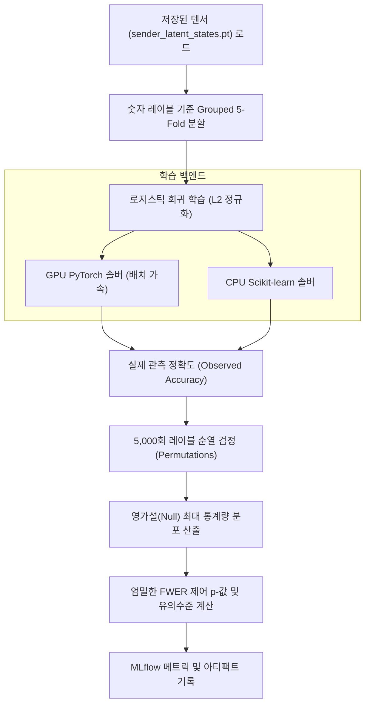

# Sender Probe Analysis Use Case

`SenderProbeAnalysisUseCase`는 수집된 송신자의 내부 잠재 상태(`sender_latent_states.pt`)를 바탕으로, 모델을 메모리에 로드하지 않고(Zero-Inference) 비밀 정보가 **어떤 레이어와 잠재 스텝에서 선형 분리 가능한 형태(Linearly Decodable Representation)**로 인코딩되어 있는지를 통계적으로 규명하는 분석 유스케이스입니다.

---

## 1. 개요 및 연구 목적

* **연구 목적**:
  - 송신자가 $T$개의 잠재 스텝을 거치면서 비밀 숫자(Secret Digit: $0 \sim 9$) 정보를 자신의 내부 활성화 벡터에 언제, 어떻게 저장하는지 추적(Representation Probing)합니다.
  - 정렬 변환 전의 원본 트랜스포머 히든 상태(`hidden_pre_realign`)와 정렬 후 잠재 토큰 벡터(`latent_post_realign`) 간의 정보 보존도를 비교합니다.
  - 통계적 유의성 확보를 위해 단순 검정이 아닌, 엄격한 **최대 통계량 기반 순열 검정(Max-Statistic Permutation Test)**을 수행하여 다중 비교(Multiple Comparisons) 오류를 통제합니다.

---

## 2. 대응 클래스 및 시스템 위치

* **애플리케이션 클래스**: [`SenderProbeAnalysisUseCase`](file:///home/user3/projects/latentmas-reprop/src/latentmas_reprop/application/sender_probe/use_case.py)
* **세부 모듈 (`latentmas_reprop.application.sender_probe`)**:
  - `analysis.py`: 프로브 분석 전체 파이프라인 관리 및 통계량 계산
  - `folds.py`: 숫자 클래스별 Grouped 5-Fold 교차 검증 분할
  - `torch_solver.py`: PyTorch 기반 고속 GPU 배치 선형 분류기 솔버
  - `estimator.py`: Scikit-learn 기반 CPU 로지스틱 회귀 솔버
  - `replacement.py`: 기존 MLflow 런의 원자적 교체 및 메타데이터 보존
* **실행 모듈 진입점**:
  - `src/run/sender_probe.py`
* **실행 레시피**: `just analyze-sender-probe`

---

## 3. 분석 파이프라인 및 통계 검정



### 1) Grouped 5-Fold 교차 검증
* $0 \sim 9$까지의 10개 클래스가 각 Fold에 균등하게 포함되도록 계층화(Stratified) 분할을 수행하여 과적합과 데이터 누수를 방지합니다.

### 2) 고속 GPU 배치 순열 솔버 (`torch_solver.py`)
* 순열 검정을 위해 5,000회의 독립적인 분류기를 CPU에서 루프로 돌리면 수 시간이 소요될 수 있습니다.
* `SenderProbeAnalysisUseCase`는 PyTorch 텐서 연산을 통해 5,000개의 순열 분류기를 GPU에서 일괄 배치(Batching)로 병렬 최적화하여 수 분 내에 검정을 완료합니다.

### 3) 최대 통계량(Max-Statistic) 다중 비교 보정
* 각 레이어 $\times$ 각 잠재 스텝마다 가설 검정을 수행할 때 발생하는 패밀리 와이즈 오류율(Family-Wise Error Rate, FWER)을 보정하기 위해, 순열별 최대 통계량 분포(Max-T distribution)를 구성하여 정규성 가정 없이 엄격한 유의확률($p$-value)을 산출합니다.

---

## 4. 실행 방법 및 명령어 예시

### 4.1 로컬 저장 텐서 직접 분석 (모델 추론 불필요)
```bash
just analyze-sender-probe \
  --states .cache/evaluation/receiver_acquisition/sender_latent_states.pt \
  --source-config configs/lmas/secret_digit/preflight.yaml
```

### 4.2 MLflow 기존 런 ID를 지정하여 분석 및 런 교체
```bash
# GPU 백엔드로 5,000회 순열 검정을 수행하고 기존 MLflow 런 메타데이터 갱신
just analyze-sender-probe \
  --source-run-id <RUN_ID> \
  --replace-source-run \
  --backend torch \
  --permutations 5000 \
  --batch-size 256
```

---

## 5. 주요 설정 및 CLI 인자

| CLI 인자 | 타입 | 기본값 | 설명 |
| :--- | :--- | :--- | :--- |
| `--states` | `Path` | - | 분석할 `sender_latent_states.pt` 파일 경로 |
| `--source-run-id` | `str` | - | 원본 수집 실행의 MLflow Run ID |
| `--backend` | `str` | `auto` | 최적화 백엔드 (`auto`, `torch`, `sklearn`) |
| `--permutations` | `int` | `5000` | 영가설 분포 생성을 위한 순열 반복 횟수 |
| `--folds` | `int` | `5` | 교차 검증 Fold 수 |
| `--c` | `float` | `1.0` | 로지스틱 회귀 L2 역정규화 계수 |
| `--batch-size` | `int` | `256` | GPU 솔버의 동시 순열 처리 배치 크기 |
| `--replace-source-run` | `flag` | `false` | 기존 소스 런의 메트릭/아티팩트를 안전하게 갱신 후 원자적 교체 |

---

## 6. 결과 산출물 및 해석

분석이 완료되면 MLflow 및 로컬 아티팩트에 다음 지표들이 기록됩니다:
* `probe_accuracy`: 레이어별/스텝별 실제 분류 정확도
* `null_mean`, `null_std`: 순열 검정으로 얻어진 무작위 추정치 분포
* `p_value_raw`: 개별 가설의 단독 유의확률
* `p_value_max_stat`: FWER 다중 비교 보정이 적용된 보수적 유의확률 ($p < 0.01$일 때 해당 레이어/스텝에 정보가 유의미하게 존재함을 의미)
