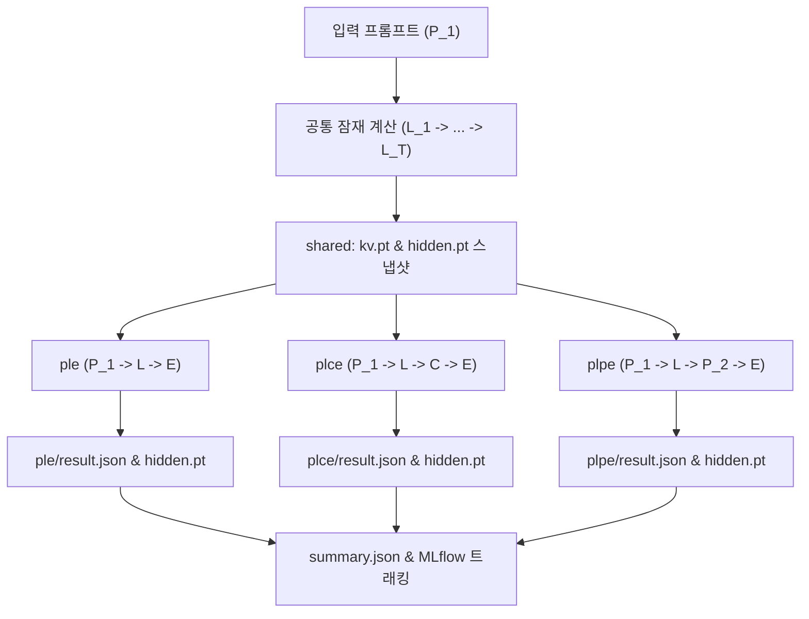

# LMAS Single Intervention Analysis (PLE, PLCE, PLPE)

이 문서는 비학습 hidden-state feedback을 수행한 동일한 잠재 계산 상태($P_1 \to L_1 \to \dots \to L_T$)에서 세 가지 조건(`ple`, `plce`, `plpe`)으로 독립 분기하여 명시적 계산 전환 및 프롬프트 개입 시 발생하는 계산적 현상을 관찰하는 **Single Intervention Analysis**의 실행, 설정, 저장 구조 및 증분 재개(Incremental Resumption) 명세를 설명합니다.

---

## 1. 개요 및 연구 목적

* **연구 목적**: 동일한 상위 잠재 상태($P_1 \to L$)에서 디코딩 조건에 변화를 주었을 때 모델의 내부 표상과 명시적 텍스트 생성 양상을 비교 관찰합니다.
* **실행 조건**:
  | 조건 | 계산 구조 | 개입 내용 | 설명 |
  |---|---|---|---|
  | `ple` | $P_1 \to L \to E$ | 추가 입력 없음 | $L_T$ 상태에서 추가 토큰 개입 없이 직접 명시적 디코딩 수행 |
  | `plce` | $P_1 \to L \to C \to E$ | 제어 신호 ($C$) | 지정된 제어 신호(기본값: `\nSolution:`) 주입 후 디코딩 |
  | `plpe` | $P_1 \to L \to P_2 \to E$ | 역할 및 문제 프롬프트 ($P_2$) | LatentMAS 원본 수신 에이전트(기본값: Judger) 역할 지시문 및 목표 문제 재제시 후 디코딩 |

---

## 2. 대응 클래스 및 시스템 위치

* **애플리케이션 클래스**: [`SingleInterventionUseCase`](file:///home/user3/projects/latentmas-reprop/src/latentmas_reprop/application/single_intervention_use_case.py)
* **세부 모듈**:
  - `latentmas_reprop.application.single_intervention.runner`: 공통 잠재 연산 및 3개 분기 디코더 오케스트레이션
  - `latentmas_reprop.application.single_intervention.checkpoint`: 10스텝 단위 중간 체크포인트 저장 및 증분 재개 탐색
  - `latentmas_reprop.application.single_intervention.artifacts`: 메트릭 집계 및 MLflow/디스크 원자적 저장
* **실행 모듈 진입점**:
  - `src/run/main.py` -> `src/run/runner.py` (`--single_intervention` 플래그)
* **실행 레시피**: `just run-single-intervention`

---

## 3. 핵심 유스케이스 흐름 (UC-01 ~ UC-04)



### UC-01. 공통 잠재 계산 (`shared`)
* 상위 Planner 프롬프트($P_1$)로부터 $T$개의 잠재 스텝($L_1 \to \dots \to L_T$)을 수행합니다.
* 샘플당 단 1회만 계산하며, 분기 직전 전체 KV 캐시 스냅샷(`kv.pt`)과 프롬프트 및 각 잠재 스텝의 최종 히든 벡터(`hidden.pt`)를 저장합니다.

### UC-02. 세 조건으로 독립 분기
* 모든 조건은 `shared`에서 저장된 동일한 분기 직전 상태를 복제(`clone_past_kv`)하여 시작합니다.
* 분기 이후 생성되는 토큰과 KV 상태는 서로 완전히 독립적으로 갱신됩니다.
* 개입 토큰 및 생성 구간의 위치별 최종 히든 벡터를 1:1 대응하여 기록합니다.

### UC-03. 완료 판정 및 재실행 정책
* 조건별 `result.json`과 필수 파일(`hidden.pt`, `kv.pt`)의 존재 여부가 완료 판정의 유일한 진실 공급원(Source of Truth)입니다.
* 중단 후 재실행 시 완료된 조건은 건너뛰고 미완료된 조건만 계산합니다.
* `--overwrite` 플래그가 지정된 경우에만 해당 샘플/조건을 재계산합니다.

### UC-04. 사후 분석
* 원본 추론을 재실행하지 않고, `ResearchDataReader`를 통해 저장된 `hidden.pt`와 `kv.pt`를 직접 로드하여 로짓/엔트로피 복원, 상태 변화 분석, 추가 개입 실험을 수행합니다.

---

## 4. 중간 체크포인트 자동 저장 및 증분 재개 (Incremental Resumption)

### 1) 10스텝 단위 중간 체크포인트
잠재 스텝은 인과적(Causal) 누적 연산이므로, $T=40$을 수행하는 도중의 $T=10, 20, 30$ 상태는 해당 스텝 수 단독 실험의 상태와 수학적으로 100% 동일합니다.
* 기본 설정(`latent_step_checkpoint_interval: 10`)에 따라 10스텝마다 중간 `shared` 스냅샷(`ls10`, `ls20`, `ls30` 등)이 자동 보관됩니다.

### 2) 증분 재개 (Incremental Resumption)
* 예를 들어 기존에 `ls20` 실험이 완료된 상태에서 `--latent_steps 40`을 실행할 경우:
  1. 기존 `ls20` 경로의 `shared/kv.pt` 및 `shared/hidden.pt`를 자동으로 감지합니다.
  2. 프롬프트 및 1~20스텝 연산을 완전히 건너뜁니다 (0초 소요).
  3. 21~40스텝(20회)만 추가 forward한 뒤, 히든 궤적을 병합하여 `ls40`에 저장하고 분기 디코딩을 수행합니다.
  4. 도중에 통과하는 30스텝 시점에는 `ls30` 체크포인트도 자동으로 저장됩니다.

---

## 5. 영구 저장 구조 (저장 정책 v2.1)

결정론적 5단계 경로 구조(`storage/experiments/<task>/<model>/<method>/<prompt>/<params>/`)를 엄격히 준수합니다:

```text
storage/experiments/gsm8k/Qwen3-8B/latent_mas/sequential/ls20_seed42_temp0.6_top0.95_mt2048_float16_single_intervention/
  ├── config.json
  ├── summary.json
  ├── samples.jsonl
  └── samples/
        ├── 000000/
        │     ├── shared/
        │     │     ├── hidden.pt     # 프롬프트 + 20스텝 잠재 히든 궤적
        │     │     ├── kv.pt         # 분기점 직전 전체 KV 캐시 스냅샷
        │     │     └── result.json   # 공통 구간 메타데이터
        │     ├── ple/
        │     │     ├── hidden.pt     # 생성 토큰별 히든 벡터
        │     │     └── result.json   # 생성 텍스트, 정답 여부, 평가 메타데이터
        │     ├── plce/
        │     │     ├── hidden.pt     # 제어 신호 + 생성 토큰 히든 벡터
        │     │     └── result.json
        │     └── plpe/
        │           ├── hidden.pt     # Judger 프롬프트 + 생성 토큰 히든 벡터
        │           └── result.json
        └── 000001/
              └── ...
```

### 경로 격리 규칙
바리언트 옵션 변경 시 서로 다른 계산 결과가 덮어써지지 않도록 경로 파라미터가 자동으로 격리됩니다:
* 기본: `..._single_intervention`
* 제어 신호 변경 시: `..._single_intervention_sig_<clean_sig>`
* 수신자 역할 변경 시: `..._single_intervention_role_<role>`
* 커스텀 프롬프트 지정 시: `..._single_intervention_plpe_<clean_prompt>`

---

## 6. 실행 설정 및 프리셋

기본 프리셋 파일: [`configs/lmas/single_intervention/gsm8k.yaml`](file:///home/user3/projects/latentmas-reprop/configs/lmas/single_intervention/gsm8k.yaml)

```yaml
method: latent_mas
model_name: Qwen/Qwen3-8B
task: gsm8k
prompt: sequential
max_samples: -1  # 전체 데이터셋 (1,319개)
latent_steps: 20
max_new_tokens: 2048
temperature: 0.6
top_p: 0.95
seed: 42
single_intervention: true
intervention_conditions: "ple,plce,plpe"
control_signal: "\nSolution:"
receiver_role: "judger"
latent_step_checkpoint_interval: 10
tracking_experiment_name: latentmas_single_intervention
```

---

## 7. 실행 명령어 요약

### 1) 기본 프리셋 실행
```bash
# 기본 설정으로 실행 (지정 디바이스 활성화 권장)
CUDA_VISIBLE_DEVICES=3 just run-single-intervention -c lmas/single_intervention/gsm8k
```

### 2) 파라미터 오버라이드
```bash
# 40스텝으로 실행 (기존 20스텝 체크포인트에서 21~40스텝만 증분 실행)
CUDA_VISIBLE_DEVICES=3 just run-single-intervention -c lmas/single_intervention/gsm8k --latent_steps 40

# 샘플 수 제한 실행 (스모크 테스트)
CUDA_VISIBLE_DEVICES=3 just run-single-intervention -c lmas/single_intervention/gsm8k --max_samples 10

# 제어 신호 또는 수신자 역할 변경
CUDA_VISIBLE_DEVICES=3 just run-single-intervention -c lmas/single_intervention/gsm8k \
  --control_signal "\nAnswer:" \
  --receiver_role critic
```

### 3) 드라이런 (설정 검증)
```bash
just run-single-intervention -c lmas/single_intervention/gsm8k --dry-run
```

---

## 8. 진행도 표시 모니터링 (`tqdm`)

실행 중 터미널에 3단계 계층의 실시간 진행도가 출력됩니다:
1. **전체 샘플 진행도**: `Single Intervention: 45%|████... [01:23<02:15, 12.3s/sample]`
2. **공통 잠재 스텝 진행도**: `Common latent (21..40): 75%|███████▌...`
3. **조건별 토큰 생성 진행도**: `Decoding · PLE: 15%|█▌...`, `Decoding · PLCE: ...`, `Decoding · PLPE: ...`

*(진행도 출력을 끄려면 `--no_progress` 옵션을 추가합니다.)*

---

## 9. MLflow 실시간 트레이스 로깅 및 자동 백필 (Backfill)

* **실시간 Run 및 샘플 트레이스 전송**:
  - 실험 시작 시점에 즉시 MLflow Run을 생성하고 설정 파라미터를 기록합니다.
  - 각 샘플이 완료될 때마다 루트 트레이스(`single_intervention_sample`) 아래에 다음 하위 스팬을 기록하고 즉시 플러시(`flush_traces()`)합니다:
    - `common_latent` (`CHAIN`): 상위 프롬프트 원문, 프롬프트 토큰 길이, 잠재 스텝 수
    - `decode_ple`, `decode_plce`, `decode_plpe` (`LLM`): 조건별 개입 입력 텍스트/토큰 수, 생성 텍스트, 생성 길이, 종료 사유(`finish_reason`), 예산 소진 여부(`budget_exhausted`), 예측값 및 정답 여부
  - 각 샘플 트레이스에는 정답 기대값(`expected_answer`)과 조건별 평가 피드백(`ple_correct`, `plce_correct`, `plpe_correct`)이 함께 기록되며, 생성된 `trace_id`는 각 조건의 `result.json`에 저장됩니다.
* **로컬 완료 샘플 자동 백필 (Zero-GPU Backfill)**:
  - 이미 로컬 디스크에 완료된 샘플이라도 `result.json`에 `trace_id`가 없는 경우, 재실행(또는 전체 완료 후 `_reuse_completed_run` 빠른 경로 실행) 시 무거운 `.pt` 텐서나 모델을 다시 로드하지 않고 로컬 `result.json` 메타데이터만으로 누락된 MLflow 트레이스를 자동 백필(Backfill) 업로드합니다.
